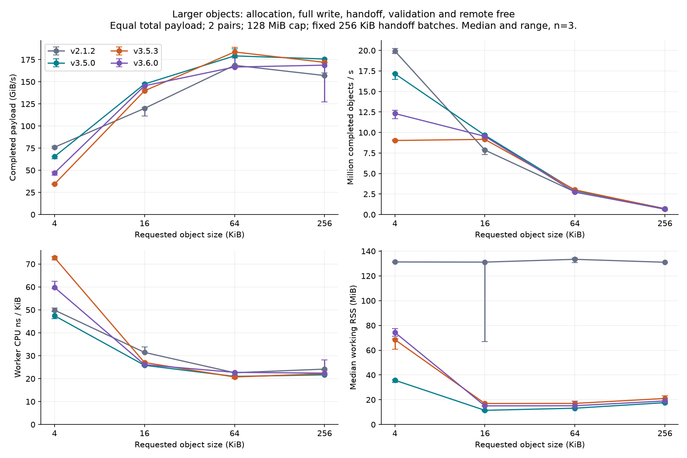

# 할당 크기를 키우면 처리량이 좋아지는가?

Execution status: Complete. Date: 2026-10-24. Experiment: allocation-size-v1.

**이번 흐름에서는 4 KiB에서 16·64 KiB로 키우면 바이트 처리량이 크게 높아졌다.**
v3.6.0은 4 KiB 대비 16 KiB에서 약 3.10배, 64 KiB에서 약 3.55배였다.
256 KiB는 64 KiB보다 안정적인 추가 이득을 보이지 않았다.
따라서 같은 데이터를 큰 할당 단위로 묶을 수 있다면 16–64 KiB 구간을 검토할
근거가 생겼다. 응용의 실제 객체를 묶는 구현 자체를 시험한 것은 아니다.

## 무엇을 어떻게 했나

A가 malloc 후 객체 전체에 값을 쓰고 B에게 인계하면 B는 앞뒤 identity를 검증하고
free했다. 독립적인 두 쌍, 총 4개 worker로 실행했다.
네 버전과 4/16/64/256 KiB의 모든 조합을 새로운 프로세스로 3번씩 관찰했다.

- 모든 조건에서 동일한 완료 payload **750.625 GiB**를 처리했다. 이 값은 누적량이다.
  동시에 살아 있는 요청량 상한은 **128 MiB**다.
- 시작 전에 128 MiB를 채운다. timed 구간의 새 할당·쓰기는 750.5 GiB이고,
  완료 payload 처리량에는 초기 적재 객체의 소비도 포함한다(차이 약 0.017%).
- 스레드 간 인계 배치는 **256 KiB**로 고정했다. 배치당 객체 수는 64/16/4/1개다.
  따라서 객체를 키워도 총 인계 횟수는 같다. 객체 할당·해제·검증 횟수는 줄어든다.
- purge_delay=1000 ms, arena_purge_mult=1로 통일했다. 나머지는 각 버전의 기본값이다.
  THP 반환 단위 차이까지 맞춘 실험은 아니다.
- 4 KiB 기준점도 새 바이너리로 다시 측정했다. 이전의 객체 256개 고정 배치와는
  인계 조건이 다르므로 과거 수치를 이번 크기 비교에 섞지 않았다.

각 크기의 완료 객체 수는 4 KiB 196,771,840개, 16 KiB 49,192,960개,
64 KiB 12,298,240개, 256 KiB 3,074,560개다.
작업량은 16조건 pilot의 가장 빠른 바이트 처리량에 3.5초를 곱해 128 MiB 배수로
올림한 뒤, 본 측정 전에 동결했다. 실제 본 실행 시간은 3.97–21.94초였다.

## 처리량과 CPU 비용

아래는 완료 payload GiB/s의 3회 중앙값이다. 전체 반복 범위는 별도 수치표에 있다.

| 버전 | 4 KiB | 16 KiB | 64 KiB | 256 KiB |
|---|---:|---:|---:|---:|
| v2.1.2 | 76.04 | 119.96 | 168.63 | 157.05 |
| v3.5.0 | 65.49 | 147.43 | 179.25 | 175.76 |
| v3.5.3 | 34.44 | 139.84 | 183.70 | 171.96 |
| v3.6.0 | 46.98 | 145.46 | 166.67 | 168.80 |

4→16 KiB의 바이트 처리량 범위는 네 버전 모두 서로 겹치지 않았고,
16→64 KiB도 네 버전 모두 겹치지 않았다. 각 3회의 탐색 결과이며 통계적 유의성
검정이나 보편적인 최적 크기 판정은 아니다.
64→256 KiB는 v2.1.2/v3.5.0/v3.5.3에서 오히려 낮아졌고,
v3.6.0은 범위가 겹쳐 안정적인 추가 이득을 확인하지 못했다.

v3.6.0의 256 KiB 결과는 127.27/171.78/168.80 GiB/s였다.
낮았던 한 실행도 무결성·환경 검증을 통과했으므로 그대로 포함했다.
원인을 따로 분리하지 않았으며 중앙값만으로 256 KiB가 더 빠르다고 판단하지 않는다.

객체 수 기준으로는 다른 모습이다. v3.6.0의 M객체/s는
4 KiB **12.32** → 16 KiB **9.53** → 64 KiB **2.73** → 256 KiB **0.69**다.
즉 한 객체를 처리하는 시간 자체가 줄었다는 뜻이 아니라,
더 적은 수의 큰 객체로 같은 바이트량을 처리할 때 효율이 좋아진 것이다.

v3.6.0의 worker CPU 비용도 **59.81 → 26.09 → 22.75 → 22.40 ns/KiB**로
줄었다. 이 값에는 할당·쓰기·검증·인계·busy wait가 모두 포함된다.
malloc/free 호출만의 비용은 아니다.

이번 4 KiB에서는 v3.6.0이 v3.5.3보다 높은 처리량을 보였다.
이전 기본 정책 실험에서 두 버전의 4 KiB 차이가 작았던 결과와 조건이 다르다.
이번에는 인계 배치를 256개에서 64개로 바꾸었고 arena 배수도 기본값 4가 아닌 1이다.
따라서 차이를 둘 중 한 변경에 귀속할 수 없으며 과거 우열을 일반화해서도 안 된다.
64 KiB에서는 v3.5.3/v3.5.0이 v3.6.0보다 높아, 최신 버전이 모든 크기에서
가장 빠르다는 결론도 나오지 않는다.

## 메모리에서 함께 달라진 점

작업 중 RSS의 중앙값(MiB, 실행 경과시간 10–90% 샘플을 요약):

| 버전 | 4 KiB | 16 KiB | 64 KiB | 256 KiB |
|---|---:|---:|---:|---:|
| v2.1.2 | 131.25 | 131.12 | 133.38 | 131.00 |
| v3.5.0 | 35.77 | 11.46 | 13.16 | 17.66 |
| v3.5.3 | 68.52 | 16.96 | 17.04 | 21.04 |
| v3.6.0 | 74.39 | 15.05 | 15.16 | 19.03 |

v3 계열은 큰 객체에서 작업 중 RSS도 낮아졌다. 그러나 초기에는 모두 128 MiB를
실제로 채웠다. 따라서 이 표는 peak RSS가 위 값까지 낮아졌다는 뜻이 아니다.
작업이 진행되면서 유지되는 메모리 수준이다.

실제 생존량도 같지 않았다. 4 KiB에서 근사 생존량 중앙값은
v3.5.0 10 MiB, v3.5.3 22.25 MiB, v3.6.0 18.5 MiB였지만,
16 KiB 이상에서는 모두 0으로 관측되는 샘플이 절반 이상이었다.
카운터는 배치 완료 시 갱신되므로 이 0은 할당된 객체가 전혀 없다는 뜻이 아니다.
진행 중인 배치 안의 객체와 샘플 사이의 변화는 표현하지 못한다.

이 결과는 큰 객체에서 대기열이 거의 쌓이지 않고 작은 메모리 집합이 반복 사용되는
흐름과 부합한다. 캐시 재사용이 높은 바이트 처리량에 기여했을 가능성이 크지만
cache miss/DRAM 트래픽을 계측해 인과 기여도를 분리하지는 않았다.
**GiB/s는 요청 크기 합계를 처리시간으로 나눈 값이며 DRAM 대역폭 측정값이 아니다.**

## 왜 좋아질 수 있는가

같은 양의 데이터를 처리할 때 객체를 4→64 KiB로 키우면 malloc/free 호출 횟수와
객체별 검증·포인터 처리 횟수가 16분의 1이 된다. 총 쓰기 바이트 수와 인계 횟수는
유지했으므로 이 고정 비용을 더 많은 바이트에 나눠 부담하는 효과가 있다.
동시에 위에서 관측한 생존량·메모리 재사용·캐시 양상도 변한다.

allocator 내부 경로도 크기 경계를 넘는다. v3.5.3의 일반 경로에서는 4 KiB가
64 KiB allocator page, 16/64 KiB가 512 KiB page, 256 KiB가 4 MiB page로 간다
(`src/arena.c:1194`, `include/mimalloc/types.h:249`). 이 page는 OS의 4 KiB page나
THP 2 MiB와 별개의 allocator 관리 단위다.
v3.6.0은 기본 cache offset 정책에서 정확히 64 KiB인 객체를 medium page에서
제외하는 조건도 있다(`include/mimalloc/alloc/page.h:81`, `src/arena/arena-page.c:784`).
따라서 크기 변화는 호출 횟수만 바꾸는 실험은 아니다.
어느 코드 변경이 처리량 차이를 얼마나 만들었는지 이번 관측으로 확정하지 않는다.

실제 응용에 적용하려면 같은 유효 데이터를 16–64 KiB 단위로 묶고,
사용이 끝난 뒤 그 단위를 해제할 수 있어야 한다. 이번 실험은 크기가 고정된 객체의
전체 쓰기와 원격 해제를 반복했다. 서로 다른 수명, 부분 접근, 실제 응용의 큰
working set에서도 같은 배수의 개선이 나온다고 예측할 수는 없다.

## 검증·환경·재현

full-payload smoke 16회, pilot 16회, measured 48회, 총 80회 모두 유효했다.
실패·제외 0, 본 실행 major fault 0. 객체 수·checksum·최종 생존량 0,
실제 옵션·라이브러리/바이너리 SHA·maps·CPU 배치·swap·throttling을 확인했다.
분석에서도 동결 hash, 실행 순서, 총 처리량 일치, 원자료 SHA를 재검증했다.

기존 검증된 네 라이브러리를 그대로 사용했다. 정확한 tag/commit/build 정보는
artifacts.json에 있다. Rocky Linux 8.9, GCC 8.5, glibc 2.28,
WSL2 Linux 6.6.87.2, Ryzen 7 5700X 노출 환경, THP madvise다.
CPU 0/2/4/6 worker, 8 제어, 10 관측, NUMA node 0, quota·memory max,
network none을 사용했다. host 부하·주파수·가상화는 미통제다.
idle은 1초만 관찰했고 강제 collect는 하지 않았다.

[설계](allocation-size-plan.md) · [전체 수치와 반복 범위](allocation-size/tables.md) ·
[재현 절차](../observation/ALLOCATION_SIZE.md) ·
[동결 계약](../experiments/allocation-size-v1/plan.json) ·
[빌드·소스·환경](../experiments/allocation-size-v1/artifacts.json) ·
[검증 상태](../experiments/allocation-size-v1/status.json) ·
[원자료 SHA](../experiments/allocation-size-v1/raw-index.json)
