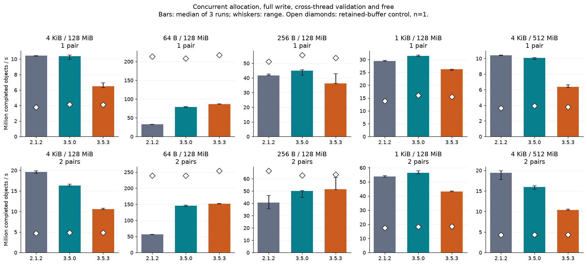
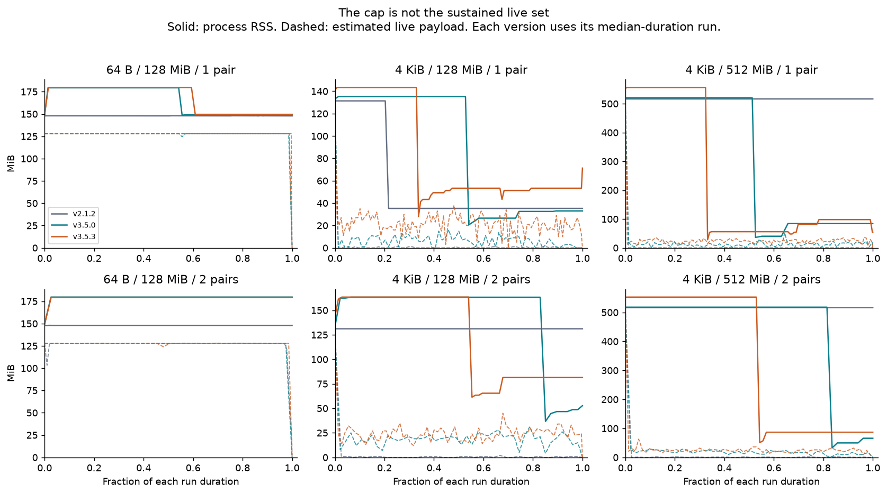

# 동시 처리와 규모 확대에서 드러난 차이

Execution status: Complete
Experiment: concurrency-v1
Date: 2026-09-22

**규모를 키우면 v3.5.3이 일관되게 유리해진다는 결과는 나오지 않았다. 객체 크기와
작업 중 실제 생존량에 따라 결과가 달랐다.** 64 B에서는 v3.5.3의 개선이 관찰됐지만,
4 KiB에서는 처리량이 낮아졌다. 512 MiB로 공간 상한을 키워도 이 방향은 유지됐다.
v2.1.2는 모든 조건에 포함했다. 작은 객체의 v2→v3 차이는 3.5.0→3.5.3 차이보다 컸다.

이는 같은 바이너리에서 할당·전체 쓰기·다른 스레드의 내용 검증·해제를 수행한 결과다.
개별 malloc/free만의 속도나 실제 서비스 요청 지연시간을 뜻하지 않는다.
각 조건은 3회이며 아래 수치는 중앙값이다. 통계적 동등성이나 모든 응용의 우열을
확정하는 실험은 아니다. [전체 반복 범위와 CPU·메모리 수치](concurrency/tables.md).

## 처리량: 크기에 따라 방향이 바뀐다

2쌍, 즉 할당자 2개와 해제자 2개를 사용한 결과다. 단위는 **백만 완료 객체/초**이며
숫자가 클수록 같은 전체 작업을 빨리 끝낸 것이다.

| 객체 / 생존 요청량 상한 | v2.1.2 | v3.5.0 | v3.5.3 | 3.5.3 / 3.5.0 변화 |
|---|---:|---:|---:|---:|
| 64 B / 128 MiB | 56.28 | 145.97 | 151.84 | +4.0% |
| 256 B / 128 MiB | 40.73 | 50.15 | 51.48 | +2.7% |
| 1 KiB / 128 MiB | 53.72 | 56.37 | 43.18 | −23.4% |
| 4 KiB / 128 MiB | 19.63 | 16.31 | 10.61 | −34.9% |
| 4 KiB / 512 MiB | 19.42 | 16.00 | 10.37 | −35.2% |

1쌍에서도 64 B는 3.5.3이 3.5.0보다 9.6% 높았지만, 1 KiB는 16.5%,
4 KiB는 약 37% 낮았다. 256 B는 1쌍에서 중앙값 기준 19.3% 낮고 2쌍에서는
2.7% 높아 방향까지 달랐다. 특히 이 크기는 반복 범위가 넓고 일부 범위가 겹치므로
작은 중앙값 차이를 안정된 개선으로 판정하지 않는다.

v2.1.2와 비교하면 64 B/2쌍에서 3.5.0은 약 2.59배, 3.5.3은 약 2.70배다.
반면 4 KiB에서는 v2.1.2가 처리량이 높고, 뒤에서 설명할 메모리 보유량도 크다.
따라서 v2를 빼면 중요한 속도·메모리 절충을 놓치게 된다.

## 쌍을 늘리는 효과와 메모리 상한을 늘리는 효과는 다르다

64 B에서 1→2쌍 처리량 증가율은 v2.1.2 약 1.73배, 3.5.0 약 1.84배,
3.5.3 약 1.75배였다. 3.5.3 자체가 빨랐지만, 병렬도를 늘릴수록 3.5.0과의
격차가 더 벌어지지는 않았다. 4 KiB/128 MiB에서는 각각 약 1.88배, 1.57배,
1.64배였고 3.5.3이 3.5.0을 따라잡지 못했다.

256 B에서 쌍을 늘린 효과는 약 0.98배, 1.12배, 1.42배로 서로 달랐다.
이때는 반복 간 변동도 커 단순한 코어 수 비례 관계가 아니다.
이 비교에서는 총 공간 상한을 고정했으므로 2쌍에서 쌍당 공간은 절반이다.
스레드 수 하나만 독립적으로 바꾼 결과라고 표현하지 않는다.

4 KiB의 상한을 128→512 MiB로 바꾼 경우에는 세 버전 모두 처리량이 비슷한
수준에 머물렀다. 그런데 **실제 생존량을 512 MiB로 유지한 것은 아니다.**
처음에는 상한을 모두 채우지만, 이후 소비 속도와 재사용 방식에 따라 줄어든다.
2쌍에서 작업 중 생존량의 중앙값은 3.5.0 약 18 MiB, 3.5.3 약 24 MiB였고,
v2.1.2는 배치 단위 관측에서 대부분 0 근처였다. 이는 정확히 객체가 없다는 뜻이
아니라 배치 공개 단위보다 작은 생존량을 분해하지 못한다는 뜻이다.

그러므로 확인한 것은 **초기 적재량과 인계 공간 상한을 크게 해도 이 흐름의
순위가 바뀌지 않았다**는 것이다. 장수 객체를 수백 MiB 계속 보유하는 흐름이나
메모리 압박이 있는 시스템에서까지 3.5.3의 이점이 없다고 확장할 수는 없다.

실선은 RSS, 점선은 배치 진행에서 추정한 생존 요청량이다. 각 버전의 처리 시간이
중앙값인 실행을 골랐으며 시간축은 해당 실행 길이로 정규화했다. 버전마다 실제
경과 시간은 다르다. [세 반복 전체 RSS 시계열](concurrency/rss.png).

## 메모리: 빠른 버전과 적게 남기는 버전이 같지 않다

아래는 **2쌍에서 모든 객체를 해제한 뒤 worker를 유지하고 5초 기다린 RSS**다.
프로세스 RSS이므로 요청한 객체 외에 포인터 배열·관리 정보·라이브러리 등도 포함한다.
각 값은 중앙값 [최소–최대]이며 단위는 MiB다.

| 객체 / 상한 | v2.1.2 | v3.5.0 | v3.5.3 |
|---|---:|---:|---:|
| 64 B / 128 MiB | 148.3 [148.2–148.3] | 179.7 [179.7–179.8] | 179.6 [179.5–179.6] |
| 256 B / 128 MiB | 103.1 [103.1–135.5] | 137.4 [136.9–137.5] | 167.3 [167.3–167.3] |
| 1 KiB / 128 MiB | 132.3 [132.3–132.4] | 136.2 [136.2–136.2] | 66.1 [62.1–68.2] |
| 4 KiB / 128 MiB | 131.5 [131.5–131.6] | 55.3 [53.4–94.6] | 81.5 [71.4–103.4] |
| 4 KiB / 512 MiB | 516.8 [40.8–516.9] | 66.1 [60.2–96.7] | 84.2 [78.3–86.8] |

- 64 B에서는 v3가 빠르지만, 2쌍에서는 처리 후 약 30 MiB를 더 남겼다.
- 1 KiB에서는 3.5.3이 3.5.0보다 느리지만, 종료 후 RSS는 약 절반이었다.
- 4 KiB에서는 v2.1.2가 빠르지만, 대부분의 실행에서 초기의 큰 RSS를 보유했다.
  v3에서는 계속 처리하는 동안 RSS가 낮아져 512 MiB에서 시작해도 종료 후에는 작았다.
- 4 KiB/2쌍에서는 3.5.0이 3.5.3보다 빠르면서 종료 후 RSS 중앙값도 작았다.

**v2.1.2가 항상 반환하지 않는 것은 아니다.** 4 KiB/512 MiB/2쌍의 실제 3회
종료 후 RSS는 40.8, 516.9, 516.8 MiB였다. 낮아진 실행도 모든 검증을 통과해
제외하지 않았다. 256 B/1쌍에서도 버전에 따라 종료 RSS가 크게 흔들렸다.
페이지 재사용·회수의 진행과 종료 시점이 맞물리는 결과로 해석할 수 있으나,
어떤 내부 경로가 해당 차이를 만들었는지는 별도 추적하지 않았다.
특히 메모리 반환량은 한 번의 값이나 중앙값만으로 고정된 버전 특성처럼 표현하면 안 된다.

이 감소는 대부분 작업 중 발생했고 idle 5초에서 다시 크게 줄어든 것은 아니다.
앞선 순차 관찰에서 “free 후 30초 기다려도 RSS가 줄지 않았다”는 사실과 모순되지 않는다.
할당을 계속하면 소유자가 remote free를 회수해 페이지를 재사용·정리하고 지연 purge를
처리할 기회가 있다. 모든 worker를 멈추고 기다리는 경우와 조건이 다르다.

## 이유로 확인한 것과 미확정 부분

**인계 코드가 모든 차이를 가린 결과는 아니다.** 같은 새 실행 프로그램으로 크기를
바꾸었을 때 방향이 달라졌고, 64 B에서는 v2와 v3의 큰 차이가 반복됐다.
다만 이것만으로 측정 코드의 비용이 0이거나 모든 조건에서 무시 가능하다는 뜻은 아니다.

별도 retained 실행은 처음 할당한 객체를 유지하고 같은 전체 쓰기·검증·인계를 반복한다.
4 KiB/128 MiB/1쌍에서 3.5.0은 18.62초, 3.5.3은 18.71초로 가까웠다.
이는 기본 흐름의 7.44초 대 11.92초와 다르다. 고정 버퍼 흐름이 오히려 느린 것은
기본 흐름에서 생존량이 줄고 더 작은 영역을 재사용할 수 있다는 관찰과 맞는다.
캐시 재사용 효과라는 해석은 가능하지만 hardware counter로 직접 입증하지는 않았다.
**대조 시간을 기본 시간에서 빼서 allocator 호출 비용을 계산할 수 없다.**
retained는 주소 집합과 메모리 사용 패턴도 바꾸기 때문이다.

64 B/1쌍에서는 retained가 세 버전 모두 약 2.6–2.8초였지만, 기본 흐름에서는
v2.1.2 17.69초, 3.5.0 7.25초, 3.5.3 6.61초였다. 이 크기의 큰 차이는
동일한 쓰기·인계 작업만으로 설명하기 어렵고, 동적 할당·원격 해제·재사용이
추가된 흐름에서 드러났다고 볼 수 있다. 대조군은 조건별 1회라 분산은 확인하지 않았다.

메모리 배치 차이는 앞선 별도 구조 진단으로 확인했다. 4 KiB 객체가 내부 64 KiB
페이지에 3.5.0에서는 16개, 3.5.3에서는 15개 들어갔다. 관리 정보와 정렬 여백
때문에 페이지당 밀도가 낮아졌으며, 가득 채웠을 때 필요한 페이지 공간은 약 6.7%
증가한다. 이번 512 MiB/2쌍 준비 상태 RSS도 약 520.2→554.2 MiB로 늘었다.
[페이지 배치 진단과 source 근거](memory-behavior-causes.md).

그러나 이 6.7% 밀도 차이만으로 약 35%의 처리량 감소까지 설명했다고 볼 수는 없다.
페이지 조회·통계·소유권·회수 경로 등 여러 변경이 함께 들어갔다.
두 v3의 `src/free.c` 모두 원격 해제에 atomic free-list 연결을 사용한다.
현재 기록으로는 특정 atomic 명령이나 커밋 하나를 회귀 원인으로 확정하지 못했다.
새 `mi_free_small` 전용 API를 직접 호출한 결과도 아니다. 일반 malloc/free를
사용했으며, 그 경로에도 페이지 배치 등의 변경은 적용된다.

## 환경과 재현 범위

같은 Rocky Linux 8.9 이미지, GCC 8.5.0, glibc 2.28, WSL2 kernel
6.6.87.2에서 수행했다. CPU는 AMD Ryzen 7 5700X로 표시되며 VM에 16개 논리
CPU/8개 core가 노출됐다. VM 메모리는 약 32 GiB다. 컨테이너는 CPU
0,2,4,6,8,10 및 NUMA node 0을 사용했고 CPU quota와 메모리 상한은 없었다.
worker는 0/2 및 4/6, 제어는 8, 외부 관찰자는 10에 고정했다. THP는
`madvise`였으며 host 설정은 바꾸지 않았다. 물리 호스트 주파수·온도·다른 부하는
통제하지 못했다. 다중 NUMA 환경은 아니다.

이미지 ID는 `sha256:73353c7a70d01f098f4adc96480273ce5d5b295bea3733c1f2faac2017e05877`이다.
세 버전 모두 새 memory-behavior 작업에서 빌드한 Release 공유 라이브러리를
SHA 검증 후 사용했다. upstream source는 수정하지 않았다. runtime 환경변수는
설정하지 않은 기본 정책이며, **구현과 버전별 기본 정책의 효과가 함께 포함된다.**

| 버전 | 고정 commit SHA |
|---|---|
| v2.1.2 | `43ce4bd7fd34bcc730c1c7471c99995597415488` |
| v3.5.0 | `18b08671c9302247bfb682286e6bf3cc1773f801` |
| v3.5.3 | `d4881d338125e1cb7c47ba4cfb398d6f7c0c8d45` |

공통 library 옵션은 Release `-O3 -DNDEBUG`, override/shared ON,
static/object/tests/secure OFF다. 실제 cache·library SHA·compiler 명령은
[artifacts.json](../experiments/concurrency-v1/artifacts.json)에 보존했다.
같은 C++17 실행 바이너리에 LD_PRELOAD로 라이브러리만 바꿨다.
네트워크를 끈 상태에서 fresh process를 사용하고 버전 순서를 seed로 무작위화했다.

객체별 시계나 전역 atomic 카운터를 넣지 않고 256개 배치로 인계했다.
초기 상한까지의 할당·쓰기와 thread 생성은 측정 밖이다. 초기 객체의 해제는
측정에 포함하며, 완료 수와 timed 구간의 신규 할당 수를 따로 기록했다.
크기별 총 완료 수는 64 B 573,795,840개, 256 B 205,012,992개,
1 KiB 198,556,672개, 4 KiB 77,266,944개로 세 버전·쌍 수 간 동일하다.
4 KiB 상한 비교에서는 초기 준비량이 달라 timed 신규 할당 수가 약 0.13% 다르다.

## 검증과 자료 위치

본 관찰 90회는 모두 정상 종료했고, 실제 allocator 경로·버전·hash, CPU 배치,
객체 내용·수·체크섬, 최종 생존량 검증을 통과했다. swap, CPU throttling 증가는
없었고 timed 구간 경계 사이 major page fault도 0이었다.
전체 payload 검증 24회와 짧은 보정 실행 24회는 본 수치에 포함하지 않았다.
최초 smoke의 1 MiB/4 KiB/2쌍 설정은 두 배치가 들어가지 않아 입력 검증에서
거부됐다. 기록을 보존하고 2 MiB로 수정한 전체 smoke를 통과한 후 설계를 동결했다.
별도 retained 대조 30회도 모두 검증을 통과했다. 본 관찰의 측정 시간은
3.35–17.98초였으며, 대조군은 더 짧거나 길 수 있다. 동결한 문서·source·runner·
artifact hash를 분석 시 다시 검증했다. 원자료에 실패한 본 관찰을 제외한 사례는 없다.

worker CPU는 고해상도 thread CPU clock이며 busy wait도 포함한다.
대기 횟수는 대기 시간으로 환산하지 않았다. RSS 샘플은 약 100 ms 간격이며
경계에는 smaps_rollup을 사용했다. 관측 사이 순간 peak와 정확한 순간 생존량은
알 수 없다. perf hardware counters, 개별 호출 latency, 서비스 tail latency는
수집하지 않았다. Release assembly에 malloc/free와 전체 memset 호출이 남아 있는지도
확인했다. [측정 한계와 코드 검토 기록](../experiments/concurrency-v1/notes.md).

- [동결 계획](concurrency-plan.md) · [정확한 작업량과 실행 순서](../experiments/concurrency-v1/plan.json)
- [실행 절차](../observation/CONCURRENCY.md) · [새 프로그램](../observation/concurrent.cpp)
- 원자료: `results/concurrency-v1/measured/`, `controls/`, `smoke-v2/`, `pilot/`
- [집계 JSON](../experiments/concurrency-v1/summary.json) · [검증 결과](../experiments/concurrency-v1/validation.json)
- [원자료 hash 목록](../experiments/concurrency-v1/raw-manifest.json)

폐기된 과거 benchmark·runner·결과는 사용하지 않았다. 앞선 새 순차 관찰은
[memory-behavior 보고서](memory-behavior-report.md)에 그대로 보존했다.
