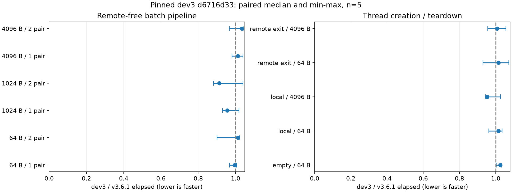

# dev3 d6716d33 직접 측정 결과

2026-11-06. Execution status: Complete. Experiment: dev3-20261106-v1.

**일반 Release에서 전반적인 성능 개선이나 메모리 반환 변화는 확인되지 않았다.**
1 KiB remote-free에서는 개선 신호가 있었지만 반복에 따라 방향이 바뀌었다.
64 B·4 KiB와 스레드 생성/종료는 대부분 작은 차이였고, 5회 탐색 측정으로
일관된 우열이나 동등성을 확정하지 않는다. MTE/PAC 하드웨어 기능과 보안 모드 성능은
이번 x86-64 / MI_SECURE=OFF 측정에 포함되지 않는다.

## 범위와 재현성

|항목|실제 설정|
|---|---|
|기준|v3.6.1, `56dc5eb80145f9a3ba7ca23d47c6a248b9d8586c`|
|대상|dev3, `d6716d33671c2f621b87be3c7ac016c6ba6b3c94` (`mi_version=30602` 개발 snapshot)|
|CPU|AMD Ryzen 7 5700X, x86-64, WSL2/Microsoft hypervisor|
|OS|Rocky Linux 8.9 컨테이너, kernel 6.6.87.2-microsoft-standard-WSL2|
|도구|GCC/G++ 8.5.0, glibc 2.28, CMake 3.26.5|
|이미지|`sha256:73353c7a70d01f098f4adc96480273ce5d5b295bea3733c1f2faac2017e05877`|
|빌드|동일 Release `-O3 -DNDEBUG`, `MI_SECURE=OFF`, shared preload; dev3 MTE/PAC OFF|
|CPU/메모리|cpuset 0,2,4,6,8,10, 서로 다른 physical core, node 0; quota 없음; 4 GiB 상한; swap 금지|
|THP|host `madvise`, 설정 변경 없음; 실제 AnonHugePages도 수집|
|반복|기본 조건당 버전별 5회, fresh process, seed 20261106으로 버전 순서 무작위화|
|실행|동일 binary + LD_PRELOAD, network none, 측정은 순차 실행|

Design status: Frozen. Frozen at: `2026-11-05T23:36:47.062966+00:00`.
Design revision (계획 문서 SHA-256):
`45e0d851e1f7cfa957870c85fad52d48e09eb2f44b5a435a80f31bd0ca7d7f36`.
[동결 계약](../experiments/dev3-20261106-v1/plan.json)은 코드·artifact·pilot hash와 실제 작업량을 포함한다.
초안 계획 문서는 동결 이후 수정하지 않았다.

**178개 raw 전부 valid**: smoke 22, pilot 22, 본 측정 130, 별도 강제 collect 4.
성능 때문에 제외한 실행은 없다. 버전/라이브러리 경로·hash, 개수·checksum,
최종 생존량 0, CPU 배치, swap과 throttling을 검증했다.
[검증 기록](../experiments/dev3-20261106-v1/verification.json)에 raw hash도 보존했다.
두 버전 모두 새로 빌드했으며 기존 동결 결과와 합치지 않았다.

## 1. Remote-free 처리 비용

생산자/소비자 1쌍 또는 2쌍, 생존 요청량 상한 128 MiB, 256객체 배치.
전체 payload 쓰기·인계·검증이 포함된 비용이다. 준비 적재는 timed region 밖이며
pilot에서 정한 동일 객체 수를 두 버전이 처리한다. 아래 값은 **같은 반복끼리의
dev3/v3.6.1 elapsed 비율**이다. 버전별 중앙값을 나눈 값과는 다를 수 있다.

|객체 크기|쌍|paired 비율 중앙값 [최소, 최대]|중앙값 기준 시간 변화|
|---|---:|---:|---:|
|64 B|1|0.996 [0.969, 1.005]|약 -0.4%|
|64 B|2|1.012 [0.901, 1.023]|약 +1.2%|
|1 KiB|1|0.956 [0.929, 1.018]|약 -4.4%|
|1 KiB|2|0.913 [0.882, 1.040]|약 -8.7%|
|4 KiB|1|1.012 [0.981, 1.040]|약 +1.2%|
|4 KiB|2|1.034 [0.967, 1.041]|약 +3.4%|

1 KiB는 개선 신호가 가장 컸지만 **모든 조건에서 paired 범위가 1을 가로지른다**.
특히 1 KiB·2쌍은 5회 중 3회 빨랐고 2회 느렸다. 안정적인 8.7% 개선이라고
일반화하지 않는다. worker CPU 중앙값은 같은 조건에서 12.16→12.09초로
elapsed 차이보다 작았다. queue 대기, 스케줄링, THP와 함께 변하는 통합 결과다.

5초 목표로 pilot을 보정했지만 실제 본 측정은 약 3.31–5.12초였다.
pilot이 짧고 준비 적재 비중이 달라 목표가 정확히 맞지 않았다.
작업량은 동결 후 변경하지 않았으며 버전 간 동일하다.

점은 중앙값, 선은 5회 최소/최대이며 신뢰구간이 아니다. 1 미만이면 dev3가 빠르다.
전체 시간·CPU·GiB/s·fault·RSS·대기 횟수는 [수치 JSON](dev3-20261106/summary.json),
읽기 쉬운 표는 [전체 표](dev3-20261106/tables.md)에 있다.

## 2. 메모리 사용과 반환

4 KiB 객체 32768개(128 MiB)를 할당하고 전체 쓰기, 절반/전체 해제,
5초 idle, 재할당을 관찰했다. 할당 스레드는 CPU0, 원격 해제는 CPU2였다.

|해제 방식|v3.6.1: 해제 후/idle 5초 RSS|dev3: 해제 후/idle 5초 RSS|
|---|---:|---:|
|같은 스레드|141.53 / 141.53 MiB|141.55 / 141.55 MiB|
|다른 스레드|143.40 / 143.40 MiB|143.51 / 143.51 MiB|

두 버전 모두 idle만으로 RSS가 감소하지 않았다. 별도 `mi_collect(true)` 진단에서는
약 143 MiB에서 **7.43–7.55 MiB**로 감소했다(각 조건 1회).
따라서 이 조건에서는 두 버전의 반환 양상이 같고, idle 잔류를 누수 증거로 볼 수 없다.

동시 처리의 peak RSS 중앙값은 64 B에서 두 버전 모두 약 179.5 MiB,
1 KiB에서 약 138–140 MiB, 4 KiB에서 약 145–147 MiB였다.
유휴 RSS는 조건에 따라 차이가 있었지만 일관된 dev3 감소 방향은 없었다.
`VmHWM`과 smaps `Rss`는 서로 다른 수집 지표여서 소폭의 수치 역전이 있을 수 있다.
thread 진단의 `ru_maxrss` 역시 process lifetime 값이며 timed region만의 peak가 아니다.

순차 malloc 시간은 v3.6.1 remote 조건에서 **12.4–586.5 ms**, dev3에서
**12.3–473.1 ms**로 크게 흔들렸다. 같은 스레드 조건의 중앙값이
51.9→31.0 ms였다는 이유만으로 allocator 개선이라고 해석하지 않는다.
재할당도 편차가 컸다. 반면 원격 전체 free 시간 중앙값은 1.272→1.274 ms로 비슷했다.

## 3. 스레드 생성·종료와 종료 후 해제

새 작은 pthread 프로그램을 작성했다. 20회 warm-up 후 매 실행 20000 cycle,
worker CPU0 / controller CPU2로 고정했다. local은 worker가 1024개 할당·해제 후
종료하고, remote_exit는 worker가 할당하고 종료한 뒤 controller가 해제한다.
first/last byte를 쓰고 검사한다. payload 전체 쓰기인 concurrent 결과와 직접 합치지 않는다.

|조건|크기|v3.6.1 us/cycle 중앙값|dev3 us/cycle 중앙값|paired 비율 중앙값 [최소, 최대]|
|---|---:|---:|---:|---:|
|empty 대조군|—|86.20|87.18|1.025 [1.003, 1.031]|
|local|64 B|99.43|101.54|1.014 [0.962, 1.035]|
|local|4 KiB|143.69|137.48|0.953 [0.943, 1.026]|
|remote_exit|64 B|107.95|114.48|1.015 [0.930, 1.073]|
|remote_exit|4 KiB|152.23|153.27|1.008 [0.956, 1.056]|

local 4 KiB에서는 감소 신호가 있었지만 모든 반복에서 같은 방향은 아니었다.
empty 대조군도 dev3가 paired 중앙값 2.5% 느렸다. 이 대조군도 pthread 내부
allocation을 포함하므로 OS 비용만이라고 할 수 없으며 다른 결과에서 빼지 않는다.
첫 명시적 malloc은 대체로 약 2.5–3.1 us였고 뚜렷한 버전 분리는 없었다.
이 시간에는 두 clock 호출과 초기화가 포함되며 pthread 내부 malloc이 먼저 실행될 수 있다.
20000 cycle 상한 때문에 실행시간은 약 1.65–3.14초로 3초 목표 미만도 있었다.

반복 생성·종료 및 종료 후 해제에서 오류는 관찰하지 않았다. 그러나 이 실험은
순차적으로 thread를 만들기 때문에 **동시 lazy pthread-key 초기화 race 수정의
정확성을 재현·증명하는 테스트가 아니다**.

## 소스 변경과 실제 명령어의 구분

소스에서는 remote-free 목록 회수가 CAS loop에서 `atomic_fetch_and(..., acquire)`로
바뀌었다. 그러나 이번 GCC 8.5/x86-64 Release 바이너리의 `_mi_page_free_collect`를
disassemble하면 **둘 다 `lock cmpxchg` 재시도 루프**를 사용한다.

- v3.6.1: `0x192ce lock cmpxchg`, 실패 시 `0x19282`로 돌아간다.
- dev3: `0x187f1 lock cmpxchg`, `jne 0x187e8`로 반복한다.

[v3.6.1 명령어](../experiments/dev3-20261106-v1/v361-page-free-collect.asm),
[dev3 명령어](../experiments/dev3-20261106-v1/dev3-page-free-collect.asm),
[소스 diff·전체 assembly hash](../experiments/dev3-20261106-v1/source-audit.json)를 보존했다.
따라서 CAS 명령 제거를 성능 원인으로 주장할 수 없다. 주변 분기·인라이닝 등도 달라졌고
이 비교는 여러 변경을 합친 snapshot 비교다. 개별 커밋의 인과는 입증하지 않았다.

## 한계와 완료 상태

- host 주파수·부하, WSL2 스케줄링과 상주 서비스는 통제하지 않았다.
- THP 설정은 같지만 실제 AnonHugePages는 버전·반복마다 달랐다. THP 효과 분리는 하지 않았다.
- 5회는 탐색 관찰이다. 최소/최대가 겹친다고 동등성이 입증되는 것도 아니다.
- MTE/PAC 하드웨어, CHECKED/ON 보안 빌드, 보안 결함 탐지율, ARM 성능은 미측정이다.
- 별도 queue-only 대조군, perf counter, p99, 대규모 NUMA sweep, commit bisect는 미실행이다.
- 소스 build에서 upstream GCC `-Wmain` 경고가 있었지만 build와 모든 검증은 통과했다.
- 추가 disassembly 명령은 구형 objdump의 옵션 미지원으로 한 번 실패했으며,
  전체 disassembly 방식으로 재실행해 확인했다. 측정 실행 실패나 데이터 제외는 아니다.

현재 판단은 **기존 v3.6.1 대비 일반 빌드의 동작은 대체로 유지되고,
1 KiB 동시 처리와 local 4 KiB 스레드 cycle에 개선 신호가 있으나 안정적 개선으로
확정할 근거는 부족하다**이다. 이번 결과만으로 dev3로의 전환을 성능상 필수로 보지 않는다.

[재현 절차](../observation/DEV3_20261106.md) · [계획](dev3-20261106-plan.md) ·
[분석기](../observation/analyze_dev3_20261106.py).
raw는 `results/dev3-20261106-v1`, build/실행 manifest·로그는
`experiments/dev3-20261106-v1`에 보존했다. 분석·그래프는 raw에서 재생성할 수 있다.
