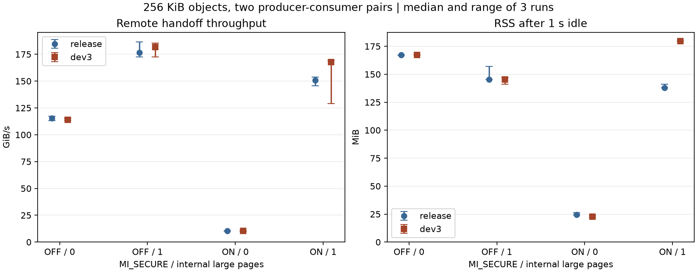

# dev3의 MI_SECURE와 내부 large page에 따른 처리량·RSS

**dev3에서 두 옵션의 상호작용이 가장 큰 조건은 256 KiB cross-thread 인계였다.** 보안 ON에서는 내부 large page를 켜면 처리량이 16.2배가 됐지만 1초 뒤 RSS는 156.8 MiB 늘었다. 보안 OFF에서는 같은 전환으로 처리량이 59.4% 늘면서 RSS가 22.0 MiB 줄었다. v3.7.0에서도 같은 방향이 관측됐다. smoke 40회, pilot 24회, 본 측정 120회 모두 유효했다. 아래 수치는 조건별 3회 중앙값이다.

| 256 KiB 빌드 | v3.7.0 처리량 (GiB/s) | dev3 처리량 (GiB/s) | v3.7.0 1초 RSS (MiB) | dev3 1초 RSS (MiB) |
|---|---:|---:|---:|---:|
| 보안 OFF · large 0 | 115.52 | 113.91 | 167.1 | 167.2 |
| 보안 OFF · large 1 | 176.47 | 181.59 | 145.3 | 145.2 |
| 보안 ON · large 0 | 10.45 | 10.33 | 24.6 | 22.7 |
| 보안 ON · large 1 | 150.83 | 167.78 | 137.9 | 179.5 |

보안 ON · large 1에서 dev3의 중앙 처리량은 릴리스보다 11.2% 높았으나 반복 범위는 129.21–169.10 대 145.56–153.90 GiB/s로 겹쳤다. 반면 같은 조건의 dev3 peak RSS는 179.2 MiB로 릴리스의 137.5 MiB보다 높았다. dev3 보안 ON · large 0에서는 peak 136.9 MiB에서 완료 관측 시점에 이미 22.7 MiB까지 낮아졌다. 1초 동안 유휴 상태로 기다린 뒤에도 중앙값은 같았다.

**작은 객체에서는 결과가 달랐다.** 64 KiB dev3에서 large page를 켜면 보안 OFF 처리량은 191.35에서 173.74 GiB/s로 9.2% 낮아졌고, 1초 RSS도 151.2에서 141.3 MiB로 낮아졌다. 보안 ON에서는 152.92와 154.41 GiB/s로 차이가 작았다. 이 보안 ON 두 빌드의 1초 RSS는 약 176 MiB로, 릴리스의 약 142 MiB보다 높았다. 4 KiB 보안 OFF의 dev3 처리량은 양쪽 모두 약 41 GiB/s였다. 4 KiB 보안 ON · large 0은 21.93–53.64 GiB/s로 변동이 커서 중앙값만으로 버전 우열을 판단하기 어렵다.

**4 KiB 해제 스레드 비교.** dev3에서 보안 OFF · large 0의 동일 스레드 해제는 32.72 ns/객체, 원격 해제는 40.66 ns/객체였다. 보안 ON · large 0에서는 각각 217.15와 195.94 ns/객체였다. 보안 ON의 원격 해제는 v3.7.0보다 large 0에서 20.1%, large 1에서 13.4% 짧았고 두 설정 모두 버전 간 3회 범위가 겹치지 않았다. 이 워크로드에서 원격·동일 해제 간 1초 RSS 중앙값 차이는 dev3의 네 빌드 모두 0.1 MiB 이하였다. 보안 ON일 때는 해제 주체와 관계없이 약 176 MiB, OFF일 때는 약 143 MiB가 남았다. 이 비교는 두 해제 구간을 측정하며 다른 스레드에 객체를 전달하는 큐의 비용은 포함하지 않는다.

## 측정 조건

2026년 11월 22일 upstream에서 확인한 dev3 커밋은 `15d1247d63b94fef02e508a8feffead8d7ac300c`였다. 비교 기준은 직전 릴리스 v3.7.0의 `1ed67b5156a763441d2ec3c20221a7b3cd866129`이다. 양쪽 모두 같은 날 새로 빌드했다. 두 커밋 모두 `mi_version()` 값이 30700이므로, 컴파일한 소스 커밋과 실제 로드 경로 및 라이브러리 SHA-256을 함께 확인했다.

각 버전의 빌드 조합은 MI_SECURE OFF(0) 또는 ON(4), MI_ENABLE_LARGE_PAGES 0 또는 1이다. 이 옵션은 mimalloc이 일정 크기의 객체를 내부 large page로 묶을 수 있게 한다. dev3의 config.h는 대상을 대략 80–512 KiB로 설명한다. 측정 중 OS의 THP 정책은 madvise였고 MIMALLOC 환경 변수는 비워 두었다. 보호 기능별 기여도는 이 비교에서 분리하지 않았다.

AMD Ryzen 7 5700X, WSL2 커널 6.6.87.2, Rocky Linux 8.9, GCC 8.5, glibc 2.28에서 측정했다. 컨테이너 cpuset은 0,2,4,6,8,10, NUMA node는 0, 메모리 한도는 6 GiB였다. 호스트 부하·동작 클럭은 고정하지 않았다.

## 지표 해석

* 동시 처리량은 두 생산자가 객체 전체에 쓰고 두 소비자가 내용을 확인하고 해제하는 동안 소비한 payload GiB/s다. 측정 시작 전에 채운 128 MiB도 소비량에 들어간다. 크기별 고정 작업량은 4 KiB에서 96 GiB, 64 KiB에서 432 GiB, 256 KiB에서 423 GiB였다. 이 수치는 재사용되는 메모리까지 누적하므로 물리 DRAM 대역폭과 직접 대응하지 않는다.
* 동시 처리의 peak RSS는 프로세스의 VmHWM이다. 해제 후 RSS는 완료를 관측한 시점, 1초 RSS는 그 시점부터 1초 뒤 smaps_rollup의 Rss다. 작업 스레드는 두 시점 모두 살아 있다.
* 스레드 자체의 차이는 별도 4 KiB 실험으로 비교했다. 같은 32,768개 객체 중 절반을 해제하고 생존 객체를 검증한 뒤 나머지를 해제했다. 두 해제 구간의 worker 시간 합을 객체 수로 나눴다. 1초 RSS는 마지막 절반을 해제한 시각을 기준으로 한다. 이후 재할당도 하므로 이 실험의 peak RSS는 재할당 구간까지 포함한다.

## 재현 및 데이터

동일 이미지와 원시 데이터용 공간을 준비한 별도 작업 복사본에서 두 커밋을 각각 `extern/mimalloc-v3.7.0`, `extern/mimalloc-dev3-15d1247d`에 체크아웃한다. 새 실행의 build, results 및 experiments 아래에 `dev3-20261122-v1` 디렉터리가 없는 상태에서 PowerShell로 `./observation/run_dev3_20261122.ps1`을 실행한다. 실행과 검증에는 Docker, 분석 및 그림 생성에는 호스트 Python과 matplotlib가 필요하다. 기존 측정값만 다시 집계할 때는 `python observation/report_dev3_20261122.py`를 실행한다.

[동결 계획](../experiments/dev3-20261122-v1/plan.json) · [전체 표](../experiments/dev3-20261122-v1/tables.md) · [반복별 지표 및 해시](../experiments/dev3-20261122-v1/metrics.json) · [원시 데이터](../results/dev3-20261122-v1/) · [빌드 및 환경](../experiments/dev3-20261122-v1/concurrent/artifacts.json)
