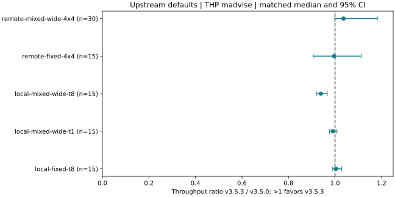
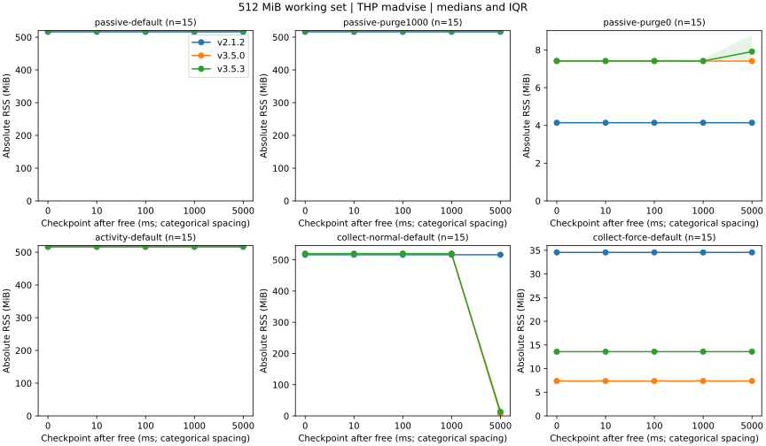

# mimalloc v3.5.3 성능 비교 (r29)

Execution status: Complete
Design status: Frozen (r29-v353-v1)

v2.1.2·v3.5.0·v3.5.3을 같은 환경에서 새로 실행했다. 과거 관측값은 합치지 않았다.

## 측정 후 해석 정정 (2026-09-21)

소스와 실제 Release 바이너리 재점검에서 서비스 record 계산이 최적화로
제거된 결함을 확인했다. 또한 아래의 allocator-only pipeline p99는
malloc 이후부터 free 직전까지의 큐 체류·중간 처리 시간이며 malloc/free
호출 지연시간이 아니다. 따라서 p99 10% 감소를 allocator 호출 성능 개선으로
해석하지 않으며, service 결과를 의도한 전체 서비스 작업의 성능으로 사용하지 않는다.
630건 valid는 당시 실행 검증 통과를 뜻하며 측정 방법의 타당성 보증은 아니다.
이 정정은 아래의 기존 해석보다 우선한다. 원시 결과와 동결 설계는 보존했다.
발견 사항과 후속 실험 요건은 [하네스 감사](r29-method-audit.md)에 기록했다.

## 주요 발견과 판단

v3.5.3의 일괄적인 성능 향상은 확인되지 않았다. v3.5.0 대비
8-worker mixed-wide local 처리량은 paired 비율 기준 약 6.1% 낮았다
(비율 0.9395, 95% CI 0.9197–0.9668). 이 셀의 allocation당 CPU 시간은
약 3.4% 증가했다. 반면 local 64 B/8-worker와 mixed-wide/1-worker의
처리량 차이는 신뢰구간이 1을 포함했다.

Remote fixed의 처리량 비율은 0.9957, remote mixed-wide는 1.0366이었다.
두 신뢰구간 모두 1을 포함하므로 remote-free 개선을 확정할 수 없다.
Queue-only 대조 실행도 library arm에 따라 5.20–6.43 M transfers/s였고,
v2.1.2/v3.5.0의 CV가 14.0–15.4%였다. 이 하네스의 queue·공유 카운터 비용과
환경 변동을 고려해야 하며, queue 시간을 allocator 시간에서 빼지 않았다.

별도 allocator-only pipeline의 p99는 paired 비율 기준 약 10.0% 짧아졌다
(0.8996, 95% CI 0.8408–0.9552). 서비스 작업을 포함한 pipeline과 p99.9는
신뢰구간이 1을 포함했다. 따라서 이 p99 개선을 실제 서비스 전반의
지연시간 개선으로 일반화하지 않는다.

기본 정책에서 모든 버전은 512 MiB를 해제한 뒤 5초 idle 동안 관측 가능한
RSS 반환이 없었다. v3.5.3의 normal/forced collect는 98.41%를 반환했고,
v3.5.0은 99.61%였다. v3.5.3의 collect 후 RSS 중앙값은 약 13.6 MiB였다.
Purge delay 0에서는 v3.5.3도 99.51%를 반환했지만, free 중앙값은
33.53 ms(기본값 0.29 ms), 다음 burst는 315.16 ms(기본값 40.11 ms)였다.
이 비용 비교는 각 조건의 중앙값을 비교한 것이며, 버전 간 paired 비율과
구분한다. 빠른 메모리 반환에는 해제·재할당 비용이 따른다.

배포 판단에서는 mixed-wide local 병렬 할당 비중이 높은 경우 이번 회귀를
실제 workload로 재확인할 필요가 있다. Remote-free 처리량 향상이나
기본 idle RSS 반환 개선만을 기대하는 업그레이드 근거는 확보하지 못했다.
Allocator-only pipeline의 p99 개선은 관찰됐으나 서비스 workload에서는
재검증해야 한다. 릴리스의 correctness 수정 가치는 성능 결과와 별도로
판단해야 하며, 이 실험은 모든 플랫폼에서 upstream 버그를 재현한 검사가 아니다.

표의 절대값은 버전별 중앙값이고, 비교 비율은 같은 repetition의 비율들을
구한 뒤 취한 중앙값이다. 따라서 절대 중앙값을 나눈 값과 다를 수 있으며,
변동이 큰 service p99에서는 방향도 달라진다. 모든 성능 판단은 표에
명시한 paired 추정값과 그 신뢰구간을 따른다.

이번 결과는 WSL2의 고정 vCPU 집합에서 얻은 결과다. 완전히 정규화한
THP/통계 기능 비교, bare-metal 재현, THP 모드 sweep, cross-NUMA,
secure/TLS build sweep, Windows-native 성능은 이번 revision에서 실행하지 않았다.


- 유효한 고유 실행: 630; 전체 시도: 630.
- 실행 시각(UTC): 2026-09-21T10:32:34.539766+00:00 ~ 2026-09-21T12:08:51.508927+00:00.
- 검증: smoke 39/39, 파일럿 63/63, 버전별 첫 C++ 할당 1000개 스레드 통과.
- AMD Ryzen 7 5700X, VM이 노출하는 8 cores (vCPU cpuset 0,2,4,6,8,10,12,14), node 0, THP madvise.
- Rocky Linux 8.9, GCC 8.5.0, glibc 2.28, WSL2 kernel 6.6.87.2, VM RAM 32036 MiB.
- 이미지: `sha256:73353c7a70d01f098f4adc96480273ce5d5b295bea3733c1f2faac2017e05877`.
- 모든 버전에 동일한 r28 benchmark binary를 사용했다. 소스·빌드 옵션·해시는 [artifacts.json](../experiments/r29-v353-v1/artifacts.json)에 있다.

## 처리량

기본 정책 비교. 수치는 median M allocations/s; 비율은 같은 block의 v3.5.3/v3.5.0 median과 bootstrap 95% CI다. 비율 >1이면 v3.5.3이 빠르다.

| Workload | matched n | v2.1.2 | v3.5.0 | v3.5.3 | v3.5.3/v3.5.0 [95% CI] |
|---|---:|---:|---:|---:|---:|
| core-local-fixed-t8 | 15 | 68.871 | 70.462 | 71.194 | 1.0042 [0.9883, 1.0287] |
| core-local-mixed-wide-t1 | 15 | 12.093 | 12.016 | 11.893 | 0.9905 [0.9766, 1.0083] |
| core-local-mixed-wide-t8 | 15 | 72.624 | 72.999 | 67.906 | 0.9395 [0.9197, 0.9668] |
| core-remote-fixed-4x4 | 15 | 5.252 | 5.216 | 5.213 | 0.9957 [0.9060, 1.1127] |
| core-remote-mixed-wide-4x4 | 30 | 5.625 | 5.069 | 5.233 | 1.0366 [0.9990, 1.1821] |

세 버전의 paired 처리량 비율 (median [95% CI]):

| Workload | v3.5.0/v2.1.2 | v3.5.3/v2.1.2 | v3.5.3/v3.5.0 |
|---|---:|---:|---:|
| core-local-fixed-t8 | 1.0321 [1.0261, 1.0519] | 1.0355 [1.0319, 1.0562] | 1.0042 [0.9883, 1.0287] |
| core-local-mixed-wide-t1 | 0.9912 [0.9735, 0.9997] | 0.9858 [0.9682, 0.9974] | 0.9905 [0.9766, 1.0083] |
| core-local-mixed-wide-t8 | 1.0056 [0.9846, 1.0248] | 0.9519 [0.9124, 0.9696] | 0.9395 [0.9197, 0.9668] |
| core-remote-fixed-4x4 | 1.0061 [0.9731, 1.0927] | 0.9932 [0.9737, 1.1168] | 0.9957 [0.9060, 1.1127] |
| core-remote-mixed-wide-4x4 | 0.8815 [0.8073, 0.9257] | 0.9412 [0.9117, 0.9697] | 1.0366 [0.9990, 1.1821] |



## CPU 시간

User + system CPU ns/allocation의 median. 여러 worker의 CPU 시간이 합산된다. 비율 <1이면 allocation당 CPU 사용량이 적다.

| Workload | v2.1.2 | v3.5.0 | v3.5.3 | v3.5.3/v3.5.0 [95% CI] |
|---|---:|---:|---:|---:|
| core-local-fixed-t8 | 115.1 | 112.2 | 111.4 | 0.9935 [0.9727, 1.0021] |
| core-local-mixed-wide-t1 | 82.5 | 83.1 | 84.0 | 1.0099 [0.9896, 1.0280] |
| core-local-mixed-wide-t8 | 108.6 | 108.5 | 113.4 | 1.0335 [1.0037, 1.0633] |
| core-remote-fixed-4x4 | 1517.6 | 1528.7 | 1529.6 | 1.0061 [0.8991, 1.0459] |
| core-remote-mixed-wide-4x4 | 1415.0 | 1572.7 | 1522.2 | 0.9641 [0.8458, 1.0009] |

## 메모리 반환

512 MiB를 page-touch 후 해제하고 5초 관찰했다. 수치는 baseline RSS를 뺀 반환율(%). Purge delay만 일치시킨 결과는 THP·통계 기능까지 완전히 정규화한 결과가 아니다.

| Condition | matched n | v2.1.2 | v3.5.0 | v3.5.3 | 다음 burst 시간 v3.5.3/v3.5.0 [95% CI] |
|---|---:|---:|---:|---:|---:|
| memory-passive-default | 15 | 0.00% | 0.00% | 0.00% | 0.9415 [0.8596, 1.0170] |
| memory-passive-purge1000 | 15 | 0.00% | 0.00% | 0.00% | 0.9063 [0.8172, 0.9754] |
| memory-passive-purge0 | 15 | 99.88% | 99.61% | 99.51% | 1.0138 [0.9775, 1.0359] |
| memory-activity-default | 15 | 0.00% | 0.00% | 0.00% | 0.8992 [0.8818, 0.9385] |
| memory-collect-normal-default | 15 | 0.00% | 99.61% | 98.41% | 1.0305 [0.8713, 1.4158] |
| memory-collect-force-default | 15 | 93.94% | 99.61% | 98.41% | 1.0410 [0.8163, 1.0947] |

v3.5.3의 절대 비용과 해제 후 RSS (중앙값):

| Condition | 5초 RSS (MiB) | free (ms) | collect/activity 합계 (ms) | 다음 burst (ms) |
|---|---:|---:|---:|---:|
| memory-passive-default | 519.57 | 0.29 | 0.00 | 40.11 |
| memory-passive-purge1000 | 519.57 | 0.28 | 0.00 | 38.41 |
| memory-passive-purge0 | 7.91 | 33.53 | 0.00 | 315.16 |
| memory-activity-default | 519.57 | 0.28 | 0.49 | 40.00 |
| memory-collect-normal-default | 13.57 | 0.27 | 4.34 | 69.81 |
| memory-collect-force-default | 13.57 | 0.28 | 2.56 | 102.67 |



## 지연시간

별도 pipeline workload의 1/1024 표본. 측정 구간은 malloc 및 ingress 작업 이후부터 free 직전까지로, 큐 체류·중간 처리 지연이며 malloc/free 호출 지연이 아니다. 서비스 record 계산 제거 결함은 상단 정정 및 하네스 감사를 참고한다. 수치는 ns, 각 percentile의 실행 간 median이며 비율 <1이 짧은 지연시간이다. 표본 개수도 summary JSON에 기록했다.

| Workload | matched n | v2.1.2 | v3.5.0 | v3.5.3 | v3.5.3/v3.5.0 [95% CI] |
|---|---:|---:|---:|---:|---:|
| latency-isolated-allocator / p50_ns | 15 | 605869 | 620404 | 614998 | 0.9899 [0.9720, 1.0009] |
| latency-isolated-allocator / p99_ns | 15 | 7481300 | 7636700 | 7164540 | 0.8996 [0.8408, 0.9552] |
| latency-isolated-allocator / p99_9_ns | 15 | 12352100 | 12490400 | 11797600 | 0.9893 [0.6898, 1.1571] |
| latency-isolated-service / p50_ns | 15 | 1042140 | 963732 | 962254 | 1.0181 [0.9742, 1.0304] |
| latency-isolated-service / p99_ns | 15 | 6515550 | 6082530 | 5632280 | 1.0696 [0.8684, 1.1417] |
| latency-isolated-service / p99_9_ns | 15 | 11049100 | 9676530 | 9751770 | 1.0326 [0.8235, 1.2155] |

## 통계·실패·해석 범위

각 셀에 대해 평균·중앙값·표준편차·CV·범위·사분위수·IQR·95% CI와 세 버전 간 모든 paired ratio/difference를 [summary JSON](../results/summaries/summary-r29.json)에 저장했다. CPU 시간, page faults, RSS, p50/p99/p99.9 등 실제 제공된 필드도 포함한다.

Invalid reasons: `{}`. Invalid 시도는 삭제하지 않으며 재시도 기록도 보존한다. 불완전한 3버전 block은 비교에 포함하지 않는다. 단순히 느리거나 빠른 표본은 제거하지 않는다.

로컬·remote core는 기존 하네스에서 warm-up이 구현되어 있지 않다. local timing에는 작은 vector 준비와 join이 포함되며 remote에는 shared atomic checksum 비용이 포함된다. 따라서 순수 allocator 명령 비용으로 일반화할 수 없다. memory-return은 8-CPU cpuset 내 단일 스레드로 실행한다. 모든 시나리오에서 worker CPU 실측값을 내보내지는 않는다.

v3.5.3 기본값에는 THP 보존 정책, 통계·프로파일링 기능 변경이 포함된다. free 개선만을 원인으로 단정하지 않는다. core의 기존 `peak_rss_bytes` 필드는 실제 peak가 아닌 종료 시점 RSS여서 집계에는 `end_rss_bytes`로 표시했다. perf cycles/instructions 및 get_mempolicy는 권한 거부로 unavailable이다. THP 사용량을 모든 실행에서 직접 측정하지 못했고 host 주파수·Windows 부하·VM 스케줄링은 통제하지 못했다. CI는 다중 비교 보정을 하지 않았다.

## 재현

```bash
python -m unittest discover -s benchmark/tests -p 'test_*.py'
bash scripts/container/run_active.sh --stage measured --status
bash scripts/container/run_active.sh --stage measured --execute --max-blocks 0
python scripts/analyze_r29.py
```

이미 기록이 존재하면 runner가 완료된 arm을 건너뛴다. 새 환경·소스·binary·설정의 측정은 새 revision/namespace를 사용한다. Draft smoke/pilot은 보존된 draft-plan.json에 해당하며 동결 후 smoke를 재실행해 덮어쓰지 않는다. Raw: `results/active/r29-v353-v1/`. Contract, calibration, environment: `experiments/r29-v353-v1/`.

## Queue-only 대조 실행

4:4 queue로 포인터 값만 전달한 별도 진단이다. 버전당 3회이며 allocator workload의 시간에서 빼지 않는다. 처리량은 M pointer transfers/s.

| Library loaded | n | median | CV |
|---|---:|---:|---:|
| v2.1.2 | 3 | 5.259 | 14.0% |
| v3.5.0 | 3 | 6.427 | 15.4% |
| v3.5.3 | 3 | 5.198 | 0.9% |

## 추가 환경·workload 명세

컨테이너 network=none, CPU quota=0, cpuset mems=0이다. 별도 container memory limit은 설정하지 않았으며 VM에는 8 GiB swap이 구성되어 있다. 물리 host CPU pinning과 모든 실행의 swap 사용량은 검증하지 않았다. 이미지 값은 로컬 빌드 image ID이며 원격 registry에서 그대로 pull할 수 있는 주소는 아니다.

Core mixed-wide는 16 B부터 64 KiB까지 13개 2의 거듭제곱 크기를 순서대로 순환한다. 1-worker/8-worker, batch 32, random free이며 정확한 operation count는 calibration.json에 있다. Core fixed는 64 B, 8 workers, batch 1이다. Remote는 4 producers/4 consumers이며 queue capacity 등은 plan.json에 고정했다.

CMake Release -O3 -DNDEBUG, shared malloc override, secure/tracking 비활성화 조건이다. v3.5.3의 CMAKE_CXX_FLAGS_RELEASE 미사용 경고는 C-only allocator 빌드에서 발생했다. 실제 C flags와 CMakeCache는 artifacts.json에 보존했다. 원본 소스는 수정하지 않았다.
