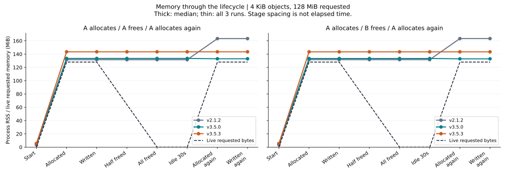
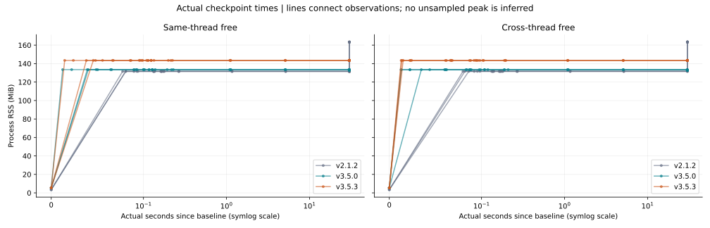
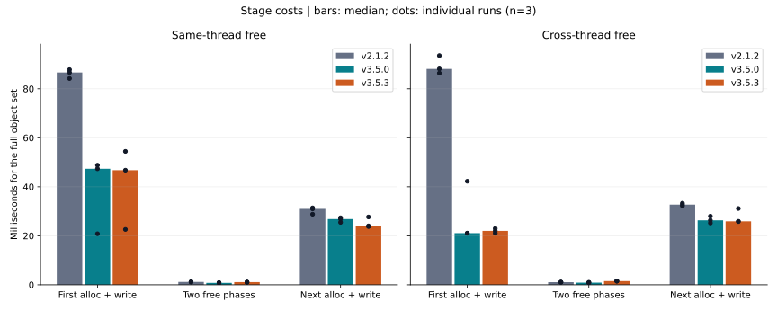

# 새 메모리 흐름 관찰 결과

Execution status: Complete (18/18 valid flows)

4 KiB 객체 32,768개, 총 요청량 128 MiB를 사용했다. 같은 스레드/다른 스레드 해제 각각에서 세 버전을 새 프로세스로 3회씩 관찰했다. 아래 수치는 중앙값 [최솟값–최댓값]이며, 작은 성능 차이를 확정하는 통계 검정은 하지 않았다.

## 이번 관찰이 알려주는 것

2026-09-22 추가 원인 확인: 실제 라이브러리의 구조 진단에서 64 KiB 페이지당
4 KiB 객체 수용량이 v3.5.0의 16개에서 v3.5.3의 15개로 줄었음을 확인했다.
아래에서 미확인으로 남겼던 RSS 증가의 주요 구조적 원인이다.
[원인 확인 기록](memory-behavior-causes.md)에 직접 관찰과 아직 남은 추정을 구분했다.

**객체를 해제하는 일, OS에 메모리를 반환하는 일, 다음 작업에 재사용하는 일은
서로 다른 시점에 나타났다.** 128 MiB의 생존 요청량을 64 MiB, 0으로 줄였지만
RSS는 거의 그대로였고, 두 worker가 살아 있는 채 30초 기다려도 감소하지 않았다.
이는 이 흐름에서 관찰한 현상이며, 모든 프로그램에서 언제까지나 반환하지 않는다는
뜻은 아니다. 객체 개수·내용·해제 검증은 통과했다.

**버전별 차이는 먼저 메모리를 잡는 방식에서 보였다.** 첫 쓰기 후 RSS는
v2.1.2 약 131.6 MiB, v3.5.0 약 133.4–133.5 MiB, v3.5.3 약 143.4–143.5 MiB였다.
실제 AnonHugePages는 각각 0, 130, 140 MiB였다. v3 두 버전의 약 10 MiB 차이는
이 장면의 THP 사용량 차이와 일치했다. 이 사실만으로 차이의 내부 원인을 확정하지는 않는다.
동일한 사용자 객체량이라도 프로세스가 점유하는 메모리는 같지 않았다.

첫 할당의 minor fault는 v2.1.2 약 32,808회, v3.5.0 68회, v3.5.3 73회였다.
따라서 첫 사용 비용에는 실제 페이지 확보 비용과 페이지 사용 정책이 포함된다.
v2.1.2는 첫 할당·쓰기 약 84–94 ms, v3 두 버전은 약 21–55 ms로 관찰됐지만,
이를 allocator 내부 명령만의 속도 차이라고 설명하지 않는다. v3의 첫 사용 시간은
변동도 컸다. 두 버전의 작은 시간 차이를 확정할 수 있는 관찰은 아니다.

**남아 있는 메모리와 재사용 때의 증가량도 구분해야 했다.** v3 두 버전은
다시 같은 128 MiB 객체 집합을 만들 때 RSS가 거의 추가 증가하지 않았다.
v2.1.2는 약 31.7 MiB 더 증가해 약 163.3 MiB가 됐고 재할당에서 약 8,121회의
minor fault가 관찰됐다. 같은 스레드 해제에서도 나타났으므로 이를 다른 스레드
해제만의 문제로 설명할 수 없다. 구체적으로 어떤 allocator 내부 공간이 남거나
재사용되지 않았는지는 이번 관찰만으로 밝히지 않았다.

**해제 담당자를 A에서 B로 바꿔도 메모리 흐름의 큰 모양은 유지됐다.**
v3.5.3의 두 해제 구간 합은 같은 스레드에서 약 1.00–1.11 ms,
다른 스레드에서 약 1.49–1.56 ms였다. 차이는 이번 객체 32,768개를 해제하는
단계 전체의 값이다. 재할당·쓰기 중앙값은 각각 약 24.0 ms와 25.9 ms였다.
이 수치로 실제 서비스의 remote-free 비용을 일반화하지 않는다. 여기서는
스레드 간 큐 경쟁 없이 목록을 일괄 인계했다.

표에서 해제 조건별 첫 할당 시간이 달라도 이를 해제 스레드의 효과로 읽으면
안 된다. **그 시점에는 아직 해제 조건이 적용되지 않았고 프로그램이 하는 일은
동일하다.** 이후 해제 담당자는 외부 제어자가 나중에 선택한다. 첫 구간 차이에는
환경·페이지 확보·배치 등 아직 분리하지 못한 변동이 포함되어 있다.

## 반환을 요청한 뒤 확인한 것

모두 해제한 직후 할당했던 A 스레드에서 `mi_collect(true)`를 한 번 호출하는
별도 진단을 추가했다. 각 조건 한 번이며 기본 관찰 3회에 합치지 않았다.

- v3.5.0은 RSS 약 133.4 → 5.4 MiB, v3.5.3은 약 143.4 → 7.4–7.5 MiB로
  감소했다. 다음 할당·쓰기에는 각각 약 40.5–41.0 ms, 45.8–46.7 ms가 들었다.
  기본 관찰의 재사용 범위는 각각 약 25.2–28.0 ms, 23.8–31.1 ms였다.
  반환을 요청한 뒤 비용이 커진 관찰이지만, 단일 진단으로 정확한 성능 비율을
  확정하지는 않는다. 반환 호출 자체는 약 0.7–0.8 ms였다.
- v2.1.2는 이 호출 뒤에도 RSS 약 131.6–131.7 MiB를 유지했다. 하지만 다음
  사용 시 약 163 MiB로 늘던 현상이 사라졌고, 재할당 minor fault는 약 8,121회에서
  9회로, 할당·쓰기는 약 29–33 ms에서 9.4–10.4 ms로 달라졌다.
  따라서 이 경우 수집 호출은 OS 반환과 다른 방식으로 재사용에 영향을 주었다고
  볼 수 있다. 내부의 구체적인 페이지 이동량은 측정하지 않았다.

v2.1.2의 [heap.c](../extern/mimalloc-v2.1.2/src/heap.c)는 수집 경로에서
지연 해제와 retired page를 처리하며, arena의 강제 수집에는 main-thread 조건을 둔다.
이번 A는 main thread가 아닌 worker다. 따라서 이번 결과를
“v2.1.2는 강제로도 OS에 메모리를 반환할 수 없다”로 일반화하지 않는다.

첫 질문에 대한 답은 메모리의 **사용 → 해제 → 내부 재사용 준비 → OS 반환 →
다음 사용**을 나눠 봐야 한다는 것이다. 이번 조건에서 해제 스레드의 변경보다
버전별 페이지 사용 및 수집 동작이 RSS 흐름에 더 큰 차이를 만들었다.
다수 스레드가 동시에 할당·해제하는 상황은 아직 답하지 않은 별도 질문이다.

## 메모리 흐름

프로세스 전체 RSS(MiB) 중앙값이다. 살아 있는 요청량은 시작 0 → 할당/쓰기 128 → 절반 해제 64 → 전체 해제/휴식 0 → 재사용 128 MiB다. RSS는 요청량과 별개이며 남은 양 전체를 누수나 단편화라고 해석하지 않는다.

| 버전 | 해제 | 시작 | 쓰기 후 | 절반 해제 | 전부 해제 | 30초 휴식 | 재사용 후 |
|---|---|---:|---:|---:|---:|---:|---:|
| v2.1.2 | A | 3.42 | 131.57 | 131.57 | 131.57 | 131.57 | 163.30 |
| v3.5.0 | A | 5.47 | 133.48 | 133.48 | 133.48 | 133.48 | 132.98 |
| v3.5.3 | A | 5.45 | 143.47 | 143.47 | 143.47 | 143.47 | 143.47 |
| v2.1.2 | B | 3.48 | 131.64 | 131.64 | 131.64 | 131.64 | 163.36 |
| v3.5.0 | B | 5.38 | 133.40 | 133.40 | 133.40 | 133.40 | 132.90 |
| v3.5.3 | B | 5.40 | 143.42 | 143.42 | 143.42 | 143.42 | 143.42 |

## 단계별 비용

전체 객체 집합을 처리하는 ms다. 첫 사용과 재사용은 각각 할당+쓰기의 실행별 합을 구한 뒤 중앙값을 냈다. 검증·경계 관찰·인계 대기·30초 휴식은 이 비용에서 제외한다.

| 버전 | 해제 | 첫 할당+쓰기 | 두 해제 구간 합 | 재할당+쓰기 |
|---|---|---:|---:|---:|
| v2.1.2 | same | 86.64 [84.20–87.81] | 1.18 [1.14–1.22] | 30.98 [28.79–31.38] |
| v3.5.0 | same | 47.35 [20.83–48.81] | 0.77 [0.77–0.87] | 26.81 [25.48–27.34] |
| v3.5.3 | same | 46.76 [22.59–54.45] | 1.09 [1.00–1.11] | 24.02 [23.78–27.68] |
| v2.1.2 | remote | 88.12 [86.39–93.54] | 1.06 [1.06–1.07] | 32.72 [32.18–33.28] |
| v3.5.0 | remote | 21.08 [21.04–42.26] | 0.87 [0.87–1.02] | 26.30 [25.21–27.99] |
| v3.5.3 | remote | 22.01 [21.06–22.98] | 1.52 [1.49–1.56] | 25.89 [25.80–31.13] |

할당과 쓰기를 분리한 ms 중앙값:

| 버전 | 해제 | 첫 할당 | 첫 쓰기 | 재할당 | 재쓰기 |
|---|---|---:|---:|---:|---:|
| v2.1.2 | same | 77.56 | 9.11 | 20.87 | 8.82 |
| v3.5.0 | same | 38.42 | 9.09 | 17.77 | 8.68 |
| v3.5.3 | same | 37.48 | 9.28 | 15.66 | 8.90 |
| v2.1.2 | remote | 78.40 | 9.71 | 22.63 | 9.68 |
| v3.5.0 | remote | 12.25 | 8.80 | 17.49 | 8.31 |
| v3.5.3 | remote | 13.03 | 8.72 | 17.80 | 8.83 |

## 실제 페이지 사용과 CPU 비용

AnonHugePages는 사용된 THP의 관측값이다. 설정 문자열만 보고 사용을 추정하지 않았다. minor fault는 오류가 아니라 페이지 매핑 등을 처리한 횟수다. 아래는 실행별 값의 중앙값이다. 짧은 해제 단계에서 RUSAGE_THREAD CPU 시간이 0으로 보고돼 이 구간의 CPU 비용은 해상도 부족으로 표시했다. CPU 비용이 없다는 뜻이 아니며 해제 시간은 벽시계 측정값으로만 해석한다.

| 버전 | 해제 | 첫 쓰기 후 THP MiB | 첫 할당 minor faults | 첫 할당+쓰기 CPU ms | 해제 CPU ms | 재할당+쓰기 CPU ms |
|---|---|---:|---:|---:|---:|---:|
| v2.1.2 | same | 0.00 | 32808.00 | 81.03 | 해상도 부족 | 26.96 |
| v3.5.0 | same | 130.00 | 68.00 | 44.73 | 해상도 부족 | 23.35 |
| v3.5.3 | same | 140.00 | 73.00 | 43.20 | 해상도 부족 | 19.13 |
| v2.1.2 | remote | 0.00 | 32808.00 | 83.50 | 해상도 부족 | 26.81 |
| v3.5.0 | remote | 130.00 | 68.00 | 17.60 | 해상도 부족 | 22.26 |
| v3.5.3 | remote | 140.00 | 73.00 | 18.11 | 해상도 부족 | 23.06 |

## 명시적으로 반환시킨 뒤 다시 사용하면

기본 관찰 이후 선택한 별도 진단이다. 전체 해제 직후 A에서 mi_collect(true)를 한 번 호출했다. 나머지 흐름과 30초 휴식은 같다. 각 조건 한 번이므로 아래 비용은 개별 관측값이며 성능 순위로 사용하지 않는다.

| 버전 | 해제 | collect 전 RSS MiB | collect 후 RSS MiB | 30초 후 RSS MiB | collect ms | 다음 할당+쓰기 ms |
|---|---|---:|---:|---:|---:|---:|
| v2.1.2 | remote | 131.64 | 131.64 | 131.64 | 0.56 | 9.44 |
| v3.5.0 | remote | 133.39 | 5.39 | 5.89 | 0.69 | 41.03 |
| v3.5.3 | remote | 143.40 | 7.40 | 7.40 | 0.73 | 45.81 |
| v2.1.2 | same | 131.67 | 131.67 | 131.67 | 0.01 | 10.35 |
| v3.5.0 | same | 133.39 | 5.39 | 5.89 | 0.80 | 40.51 |
| v3.5.3 | same | 143.48 | 7.48 | 7.48 | 0.75 | 46.65 |

## 측정 범위와 한계

- A=CPU 0, B=CPU 2, 제어=CPU 4, 외부 관찰=CPU 6. WSL2 vCPU 배치이며 물리 호스트 스케줄링과 주파수는 통제하지 못했다.
- 같은 Rocky Linux 8.9 이미지와 GCC 8.5.0, 동일한 새 프로그램을 사용했다. 공식 소스에서 라이브러리도 새 경로에 빌드했다. 이미지 ID와 SHA, 빌드 옵션, 실제 환경은 artifacts.json에 있다.
- 기본 정책 비교다. THP는 madvise이며 버전의 THP·purge 기본 정책을 완전히 같게 만든 비교는 아니다.
- RSS는 worker가 멈춘 경계에서 외부 smaps_rollup으로 읽었다. 순간 최고값은 측정하지 못한다. 프로세스 VmHWM은 raw와 summary에 별도로 있다.
- 데이터 검증은 별도 단계에서 전체 생존 바이트를 읽는다. 작업 비용에는 넣지 않았지만 뒤따르는 단계의 cache 상태에는 영향을 줄 수 있다.
- 같은 객체 목록을 일괄 인계한다. 실제 서비스 큐, 동시 할당·해제, 다수 worker 경쟁, 다른 크기와 수명의 효과는 아직 관찰하지 않았다.
- 세 번의 탐색 관찰이다. 숫자가 비슷하다고 동등성이 입증되는 것은 아니며, 작은 시간 차이는 우열로 표현하지 않는다.

## 재현과 근거

[실행 절차](../observation/README.md), [새 계획](memory-behavior-plan.md), [전체 요약과 실행별 값](../experiments/memory-behavior-v1/summary.json), [빌드·환경](../experiments/memory-behavior-v1/artifacts.json), [원자료 해시](../experiments/memory-behavior-v1/raw-index.json).

기존 실험 결과는 이 분석에 사용하지 않았다.
