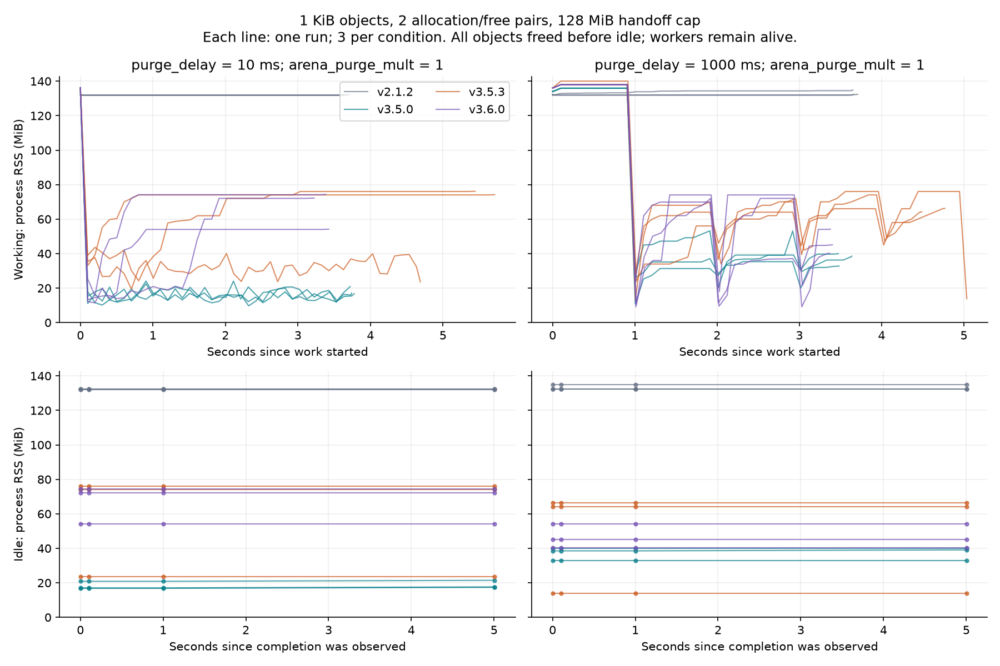

# 대기시간을 맞추면 RSS 패턴도 같아지는가?

Execution status: Complete. Date: 2026-10-24. Experiment: purge-delay-v1.

후속 코드 분석: [v3.5.0의 낮은 RSS와 THP 반환 단위 차이](purge-policy-code-analysis.md).

**v3 계열의 반환 시점은 비슷해졌다. 하지만 남는 메모리 양까지 같아지지는 않았다.**
1,000 ms 조건에서는 v3 세 버전 모두 작업 중 대략 1초 간격으로 RSS가 급감하는
톱니 모양을 보였다. v2.1.2는 두 조건 모두 약 132 MiB를 계속 유지했다.
따라서 대기시간은 RSS 곡선의 중요한 원인이지만 버전 차이 전체를 설명하지 못한다.

## 무엇을 어떻게 했나

1 KiB 객체를 A가 할당하고 전체에 값을 쓴 뒤 B에게 넘겨 해제시켰다.
독립적인 A/B 두 쌍, 총 4개 worker를 사용했다. 처음에는 요청 메모리 128 MiB를
채워 놓고 시작했다. 이후 인계 공간의 상한도 128 MiB이며 실제 생존량은 그보다 작다.
각 실행에서 동일한 193,755,136개 객체를 처리했다. 시작 전에 채운 객체도 이 수에
포함된다. 마지막 객체까지 해제한 후 worker를 종료하지 않고 5초 동안 쉬게 했다.
idle 중 추가 할당·해제나 강제 collect는 하지 않았다.

네 버전에서 purge_delay를 각각 10 ms, 1,000 ms로 설정했다.
arena 대기시간은 purge_delay에 arena_purge_mult를 곱하므로 이 배수도 모두 1로 맞췄다.
버전별 기본값은 실제 getter로 확인했다.

| 버전 | 기본 purge_delay | 기본 arena_purge_mult | 이번 배수 |
|---|---:|---:|---:|
| v2.1.2 | 10 ms | 10 | 1 |
| v3.5.0 | 1,000 ms | 4 | 1 |
| v3.5.3 | 1,000 ms | 4 | 1 |
| v3.6.0 | 1,000 ms | 4 | 1 |

즉 **앞선 v3.5.3과 v3.6.0의 차이는 서로 다른 기본 purge_delay 때문은 아니었다.**
이번 비교는 두 대기 옵션을 맞춘 비교다. 모든 메모리 정책을 동일하게 만든 비교도,
기존 기본값 대비 purge_delay 하나만 바꾼 효과를 분리한 비교도 아니다.

각 버전·시간 조합을 새로운 프로세스로 3회씩, 총 24회 실행했다. 반복 블록 안에서
8개 조건의 순서를 섞었다. 별도로 기본 옵션 확인 4회와 전체 payload 검증 8회를 수행했다.
이전 실험의 측정치를 새 표본으로 합치지 않았다.

## 곡선이 보여 주는 것

위쪽은 작업 시작 이후 실제 경과시간, 아래쪽은 완료를 관측한 뒤의 시간이다.
각 선은 한 번의 실행이며 같은 색의 선이 3개씩 있다. 모든 그래프의 세로축은 같은 범위다.

- **1,000 ms:** v3는 처음 약 1초 동안 큰 RSS를 유지하다가 함께 급감한다.
  이후에도 약 1초 간격으로 내려간다. 대기시간을 맞추면 반환 주기가 정렬되는 모습이다.
  다만 내려간 뒤 다시 올라가는 높이와 최저점은 버전·실행에 따라 다르다.
- **10 ms:** v3의 초기 RSS 감소가 첫 약 100 ms 샘플 이내로 앞당겨진다.
  100 ms 관측 간격으로 10 ms 단위의 동작을 직접 분해할 수는 없다.
  v3.5.0은 낮은 수준을 유지하지만 v3.5.3/v3.6.0은 더 높은 수준으로 올라가는 실행이 있다.
- **v2.1.2:** 두 시간 모두 RSS가 거의 내려가지 않는다. 이번 흐름에서는 대기시간을
  맞추는 것만으로 v3처럼 작업 중 반환하는 패턴이 만들어지지 않았다.
- **작업 종료 후:** 24회 모두 idle 5초 사이에 RSS 감소는 없었다.
  v3.5.0의 4회에서는 0.5625 MiB 증가가 있었다. 증가 원인은 이번에 분리하지 않았다.

작업 후 5초의 RSS는 다음과 같다. 단위 MiB, 3회 중앙값 [전체 범위].

| 버전 | 10 ms, 배수 1 | 1,000 ms, 배수 1 |
|---|---:|---:|
| v2.1.2 | 132.3 [132.2–132.3] | 132.4 [132.3–134.9] |
| v3.5.0 | 17.6 [17.4–21.4] | 39.1 [32.8–40.0] |
| v3.5.3 | 74.2 [23.6–76.2] | 64.2 [13.8–66.2] |
| v3.6.0 | 72.2 [54.2–74.3] | 45.1 [40.2–54.2] |

v3.5.3/v3.6.0은 두 조건 모두 범위가 겹쳤다. 이 조건에서는 이전 기본 정책 실험의
68 대 138 MiB 차이가 그대로 나타나지 않았다. 그렇다고 두 버전이 통계적으로
동등하거나 배수 변경만이 그 차이를 없앴다고 단정할 수는 없다. 이번에는 기본 정책의
장시간 실행을 같은 블록에 다시 넣지 않았으며 다른 시점의 결과를 인과 대조로 쓰지 않는다.

**최종 RSS 하나가 특히 오해를 부르는 이유:** 같은 객체 수를 처리해도 실행시간이
다르다. 이번 1,000 ms 조건에서 v3.5.3은 4.49–5.03초, v3.6.0은 3.37–3.40초였다.
톱니 곡선에서 어느 시점에 작업이 끝나느냐가 다르다. v3.5.3의 13.8 MiB 실행은
마지막 하락 직후 끝난 모습이다. 낮은 최종값 하나를 지속적인 메모리 효율로 읽으면 안 된다.
작업 중 RSS 중앙값은 같은 조건에서 v3.5.3 65.0 MiB, v3.6.0 67.9 MiB로 더 가까웠다.

## 코드로 설명할 수 있는 범위

v3.6.0의 `src/arena/arena-alloc.c:357`은 delay와 배수를 곱한다.
`:404` 부근은 반환을 예약하고, `:483` 부근은 만료 여부를 확인한다.
그러나 만료만으로 반환이 끝나지는 않는다. `:496` 부근은 최소 반환 단위에 맞는
범위를 찾고, 반환 가능한 빈 영역을 확보한 후 실제 purge를 수행한다.
`:344`와 `:349`에는 allocator 동작에서 purge를 시도하는 진입점이 있다.

따라서 설정을 맞춘 것은 **반환 대상의 대기시간**이다. free된 객체가 담긴 page가
언제 비는지, page가 언제 반환 대상으로 넘어가는지, 빈 영역이 최소 단위를 충족하는지,
반환 전에 다시 쓰이는지는 별개의 문제다. 버전별 처리 속도 차이 때문에 작업 중
생존 요청량도 같지 않았다. 1,000 ms에서 중앙값은 v3.5.3 18.75 MiB,
v3.6.0 10.00 MiB였다. 두 값은 비동기 카운터 기반 근사치다.

`src/prim/os.c:62`는 THP 설정에 따라 최소 반환 크기를 달리한다.
v3.6.0에는 일정 크기 이상을 즉시 purge하는 별도 조건도 있다(`arena-alloc.c:408`).
이번에는 이 정책들을 따로 바꾸지 않았다. 이들은 같은 delay가 같은 RSS를 보장하지
않는 코드상의 이유이며, 잔여 차이를 각각 몇 MiB 설명하는지까지 검증한 것은 아니다.
v2가 RSS를 유지한 정확한 내부 경로도 이번 실험만으로 확정하지 않는다.

idle 결과는 “설정 시간이 지나면 프로세스가 가만히 있어도 반드시 RSS가 줄어든다”는
해석과 맞지 않는다. 이 설명은 이번 관측된 코드 경로·프로그램에 대한 것으로,
모든 mimalloc 사용 형태에서 자동 반환이 불가능하다는 주장도 아니다.

## 비용과 검증

대기시간을 줄이는 데 비용이 없지는 않았다. v3.5.0에서 작업 중 minor page fault
중앙값은 1,000 ms의 4,273회에서 10 ms의 418,188회로 증가했다.
전체 흐름 처리량은 55.62→51.80 M객체/s였다. v3.5.3은 8,190→158,431회,
40.64→35.58 M객체/s였다. 이는 해당 설정에서 관측한 반환·재사용 비용과 일치하는
방향이지만 개별 malloc/free 호출 시간이나 fault만의 인과 효과를 측정한 값은 아니다.
v3.6.0 처리량은 57.38→57.24 M객체/s였고 두 조건의 반복 범위가 겹쳤다.

36개 관측 프로세스 모두 검증을 통과했다. invalid/excluded 0, 본 실행 major fault 0.
공통 실행파일 하나, 정확한 라이브러리 SHA와 maps, 실제 옵션, CPU 배치,
checksum·객체 개수·최종 생존량 0, swap·throttling을 확인했다.
준비 중 컴파일 경고 실패 1회는 측정 전에 수정했으며 별도 preparation-notes.md에 남겼다.
분석 결과 출력 시 Windows cp949 인코딩 오류는 `python -X utf8`로 재실행해 해결했다.
측정 원시 데이터 변경이나 재실행·제외는 없었다.

환경은 고정 Rocky Linux 8.9 Docker image, GCC 8.5/glibc 2.28,
Ryzen 7 5700X가 노출된 WSL2 Linux 6.6.87.2, THP madvise,
CPU 0,2,4,6(worker), 8(프로그램 제어), 10(관측), NUMA node 0이다.
네트워크 없이 실행했고 CPU quota·메모리 제한은 max였다. host 부하·주파수·가상화는
통제하지 못했다. 각 3회, 1 KiB·2쌍·128 MiB 상한에 한정된 설명이며 다른 크기나
동일 스레드 해제에 일반화하지 않는다.

[설계](purge-delay-plan.md) · [전체 수치](purge-delay/tables.md) ·
[재현 절차](../observation/PURGE_DELAY.md) ·
[정확한 커밋·빌드·환경](../experiments/purge-delay-v1/artifacts.json) ·
[동결 계약](../experiments/purge-delay-v1/plan.json) ·
[원시 데이터 SHA 목록](../experiments/purge-delay-v1/raw-index.json)
