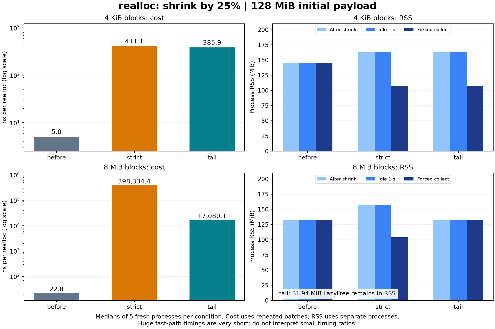

# realloc 축소 변경 직접 측정 보고서

Execution status: Completed. Experiment: realloc-20261110-v1.

## realloc을 쉽게 설명하면

`malloc`은 보관함을 새로 빌리고, `realloc`은 이미 빌린 보관함의 크기를 바꾸는 요청이다. 기존 보관함을 계속 쓸 수도 있고, 새 보관함으로 내용물을 옮긴 뒤 이전 것을 반납할 수도 있다. 작게 줄여 달라고 해도 복사를 아끼려고 큰 보관함을 유지할 수 있다. 이번 변경은 이 허용 범위를 50%에서 12.5%로 줄였고, 큰 할당에는 뒤쪽을 OS가 회수할 수 있게 표시하는 예외를 추가했다.

RSS는 프로세스가 현재 RAM에 올려 둔 페이지 양이다. 요청 크기, allocator usable size, RSS, LazyFree는 서로 다른 지표다. LazyFree는 RSS에서 즉시 빠진 바이트가 아니다.

## 비교 범위와 실행 환경

|이름|고정 commit|의미|
|---|---|---|
|before|[90d604b8](https://github.com/microsoft/mimalloc/commit/90d604b8d53ade9873387db5295304893816144e)|축소 기준 변경 직전|
|strict|[b28854bf](https://github.com/microsoft/mimalloc/commit/b28854bfea271b531c8d0da52acd72194845117b)|12.5% 기준만 적용|
|tail|[1af6580b](https://github.com/microsoft/mimalloc/commit/1af6580b14dc9f7604d6a417a058ca0ef803b29c)|huge tail reset까지 적용|

세 대상에는 same-heap 검사가 모두 들어 있다. 따라서 이 결과는 heap 이동 오류 수정의 비용 비교가 아니다. 이번 결과를 기존 d6716d33 또는 v3.6.1 실험과 합치지 않았다.

- AMD Ryzen 7 5700X, x86-64, WSL2 Linux 6.6.87.2, Rocky Linux 8, GCC 8.5.0, glibc 2.28.
- 이미지 `sha256:73353c7a70d01f098f4adc96480273ce5d5b295bea3733c1f2faac2017e05877`.
- CPU0 worker / CPU2 controller, cpuset 0,2 및 node0, 4GiB limit, swap 금지, CPU quota 없음, network none.
- Release -O3 -DNDEBUG, MI_SECURE/MTE/PAC OFF, 같은 실행파일과 LD_PRELOAD, 런타임 정책 upstream-default.
- THP always [madvise] never. 실제 AnonHugePages는 raw와 summary에 별도 기록.
- host 부하·주파수·기존 상주 컨테이너는 미통제. NUMA 메모리 정책은 cpuset-mems만 사용.

2 APIs × 2 크기 × 3 축소 비율 × 3 버전 × 5회 × 2 측정 방식 = **360 valid runs**. 추가 smoke36/pilot36/preflight3 통과. 각 프로세스는 요청량128MiB를 전체 쓰기한 뒤 축소한다. 새 크기는 실제 usable size의 15/16, 3/4, 1/4이다. 정렬 API는 64바이트 정렬이다.

비용은 warmup1 후 고정 배치 수로 반복한 realloc loop 시간 합/calls이다. 할당·memset·검증·free는 비용 timed region 밖이며, timer/loop/포인터 배열 대입 비용은 포함된다. RSS는 별도 fresh process의 단발 축소에서 측정하며 비용 반복의 메모리 상태와 합치지 않는다.

## 대표 결과: 25% 축소, 일반 realloc

중앙값이며 대괄호는 5회 최소–최대. RSS 단위는 MiB, 프로세스 전체 값이다.

|블록|버전|ns/call [min–max]|이동 비율|usable 합계|축소 직후 RSS|1초 후 RSS|강제 회수 RSS|LazyFree (1초)|
|---|---|---:|---:|---:|---:|---:|---:|---:|
|4KiB|before|5.0 [4.8–5.2]|0%|128.00|145.00|145.00|145.00|0.00|
|4KiB|strict|411.1 [387.3–415.8]|100%|96.00|163.06|163.06|107.91|0.00|
|4KiB|tail|385.9 [373.6–464.8]|100%|96.00|163.12|163.12|107.99|0.00|
|8MiB|before|22.8 [19.2–34.8]|0%|128.00|132.79|132.79|132.79|0.00|
|8MiB|strict|398334.4 [339444.1–444061.0]|100%|96.00|157.13|157.13|104.00|0.00|
|8MiB|tail|17080.1 [15343.5–25371.4]|0%|128.00|132.73|132.73|132.73|31.94|

## 해석

4KiB의 25% 축소에서 before는 원래 블록을 유지하고 strict/tail은 모두 새 블록으로 이동했다. 이로 인해 복사·새 할당·해제 비용이 추가됐다. usable 합계는 줄었지만 축소 직후와 idle1초 RSS는 오히려 커졌다. 강제 collect 뒤에는 새 버전 RSS가 낮아졌다. 빈 allocator 페이지가 OS에 즉시 반환되지 않는 것과 일치하는 관찰이며, 단순 idle이 자동 회수를 보장하지 않았다.

8MiB의 25% 축소에서 strict는 이동하지만 tail은 포인터와 usable size를 유지한다. tail에서 LazyFree 증가를 관찰했고 RSS는 바로 줄지 않았다. Linux 구현은 `_mi_os_reset`에서 `_mi_prim_reset`을 호출하고 MADV_FREE를 우선 시도한다. 따라서 이전 설명의 “반환”은 이 환경에서는 즉시 RSS 감소가 아니라 OS가 필요할 때 회수할 수 있도록 표시하는 의미다. 압박을 가해서 실제 reclaim시키는 실험은 수행하지 않았다.

6.25% 축소는 일반 작은 블록에서 기존 유지 경로를 확인하는 대조군이다. 큰 블록에서는 tail 버전이 이 작은 축소에도 reset을 시도하므로 이전의 거의 무비용 경로에 추가 비용이 발생할 수 있다. 75% 축소는 세 버전 모두 복사 경로를 확인하는 대조군이다. 정렬 API 결과는 별도 전체 표에 있으며 일반 API와 합산하지 않았다.

정렬 API의 4KiB→3KiB에서는 새 요청 합계가96MiB여도 strict/tail의 usable 합계는112MiB였다. 일반 API의96MiB와 다르다. 이는 정렬과 size class를 고려해야 함을 보여 주며, 12.5% 기준을 모든 정렬 할당의 최종 낭비율 상한으로 해석하면 안 된다.

## 전체 결과와 변동성

총 360 valid runs. 시간은 비용 반복의 batch aggregate / calls 중앙값. RSS는 별도 lifecycle 프로세스 중앙값.

|API|크기|남긴 비율|버전|ns/call|이동 %|usable MiB|할당 RSS|축소 RSS|1초 RSS|collect RSS|
|---|---:|---:|---|---:|---:|---:|---:|---:|---:|---:|
|realloc|4096|15/16|before|4.7|0|128.00|144.90|144.90|144.90|144.90|
|realloc|4096|15/16|strict|4.7|0|128.00|144.95|144.95|144.95|144.95|
|realloc|4096|15/16|tail|5.4|0|128.00|144.89|144.89|144.89|144.89|
|realloc|4096|12/16|before|5.0|0|128.00|145.00|145.00|145.00|145.00|
|realloc|4096|12/16|strict|411.1|100|96.00|144.81|163.06|163.06|107.91|
|realloc|4096|12/16|tail|385.9|100|96.00|144.87|163.12|163.12|107.99|
|realloc|4096|4/16|before|201.7|100|32.00|144.81|151.25|151.25|43.37|
|realloc|4096|4/16|strict|180.0|100|32.00|145.00|151.43|151.43|43.56|
|realloc|4096|4/16|tail|193.2|100|32.00|144.94|151.38|151.38|43.50|
|realloc|8388608|15/16|before|30.5|0|128.00|132.60|132.60|132.60|132.60|
|realloc|8388608|15/16|strict|21.5|0|128.00|132.69|132.69|132.69|132.69|
|realloc|8388608|15/16|tail|6678.0|0|128.00|132.79|132.79|132.79|132.79|
|realloc|8388608|12/16|before|22.8|0|128.00|132.79|132.79|132.79|132.79|
|realloc|8388608|12/16|strict|398334.4|100|96.00|132.64|157.13|157.13|104.00|
|realloc|8388608|12/16|tail|17080.1|0|128.00|132.73|132.73|132.73|132.73|
|realloc|8388608|4/16|before|119115.4|100|32.00|132.78|140.91|140.91|40.13|
|realloc|8388608|4/16|strict|124701.6|100|32.00|132.70|140.83|140.83|40.05|
|realloc|8388608|4/16|tail|120471.2|100|32.00|132.78|140.91|140.91|40.13|
|aligned|4096|15/16|before|6.1|0|128.00|144.90|144.90|144.90|144.90|
|aligned|4096|15/16|strict|5.6|0|128.00|144.86|144.86|144.86|144.86|
|aligned|4096|15/16|tail|5.9|0|128.00|144.86|144.86|144.86|144.86|
|aligned|4096|12/16|before|6.1|0|128.00|144.89|144.89|144.89|144.89|
|aligned|4096|12/16|strict|416.0|100|112.00|144.77|163.02|163.02|124.21|
|aligned|4096|12/16|tail|419.9|100|112.00|145.00|163.25|163.25|124.43|
|aligned|4096|4/16|before|192.4|100|32.00|144.90|151.34|151.34|43.46|
|aligned|4096|4/16|strict|202.5|100|32.00|144.90|151.34|151.34|43.46|
|aligned|4096|4/16|tail|203.3|100|32.00|144.95|151.39|151.39|43.51|
|aligned|8388608|15/16|before|28.9|0|128.00|132.60|132.60|132.60|132.60|
|aligned|8388608|15/16|strict|29.0|0|128.00|132.73|132.73|132.73|132.73|
|aligned|8388608|15/16|tail|5208.0|0|128.00|132.69|132.69|132.69|132.69|
|aligned|8388608|12/16|before|28.0|0|128.00|132.70|132.70|132.70|132.70|
|aligned|8388608|12/16|strict|338892.2|100|96.00|132.73|157.22|157.22|104.09|
|aligned|8388608|12/16|tail|18245.2|0|128.00|132.78|132.78|132.78|132.78|
|aligned|8388608|4/16|before|117181.6|100|32.00|132.75|140.88|140.88|40.09|
|aligned|8388608|4/16|strict|136383.2|100|32.00|132.70|140.82|140.82|40.04|
|aligned|8388608|4/16|tail|124879.3|100|32.00|132.73|140.86|140.86|40.08|

### 동일 반복끼리의 비용 비율

|API|블록|남긴 비율|비교|median|min|max|
|---|---:|---:|---|---:|---:|---:|
|realloc|4096|15/16|strict/before|1.007|0.966|1.104|
|realloc|4096|15/16|tail/before|1.152|1.075|1.439|
|realloc|4096|15/16|tail/strict|1.114|1.057|1.455|
|realloc|4096|12/16|strict/before|79.594|74.269|86.522|
|realloc|4096|12/16|tail/before|76.745|71.388|95.533|
|realloc|4096|12/16|tail/strict|0.939|0.903|1.200|
|realloc|4096|4/16|strict/before|0.881|0.842|1.025|
|realloc|4096|4/16|tail/before|0.997|0.905|1.047|
|realloc|4096|4/16|tail/strict|1.067|1.021|1.180|
|realloc|8388608|15/16|strict/before|0.592|0.580|1.009|
|realloc|8388608|15/16|tail/before|193.009|180.289|299.015|
|realloc|8388608|15/16|tail/strict|311.088|268.906|358.451|
|realloc|8388608|12/16|strict/before|15299.703|12326.108|20719.017|
|realloc|8388608|12/16|tail/before|749.340|441.160|1005.999|
|realloc|8388608|12/16|tail/strict|0.045|0.036|0.066|
|realloc|8388608|4/16|strict/before|1.039|0.953|1.167|
|realloc|8388608|4/16|tail/before|1.012|0.913|1.077|
|realloc|8388608|4/16|tail/strict|0.974|0.814|1.131|
|aligned|4096|15/16|strict/before|0.906|0.868|0.958|
|aligned|4096|15/16|tail/before|0.946|0.934|1.060|
|aligned|4096|15/16|tail/strict|1.088|1.030|1.108|
|aligned|4096|12/16|strict/before|68.197|62.259|74.945|
|aligned|4096|12/16|tail/before|70.585|59.663|76.568|
|aligned|4096|12/16|tail/strict|1.009|0.958|1.105|
|aligned|4096|4/16|strict/before|0.999|0.900|1.074|
|aligned|4096|4/16|tail/before|1.057|0.912|1.218|
|aligned|4096|4/16|tail/strict|1.077|0.850|1.220|
|aligned|8388608|15/16|strict/before|0.955|0.927|1.552|
|aligned|8388608|15/16|tail/before|182.454|148.116|209.737|
|aligned|8388608|15/16|tail/strict|174.396|97.642|226.215|
|aligned|8388608|12/16|strict/before|12187.623|9020.545|15202.731|
|aligned|8388608|12/16|tail/before|668.420|491.359|810.497|
|aligned|8388608|12/16|tail/strict|0.055|0.032|0.090|
|aligned|8388608|4/16|strict/before|1.117|0.943|1.191|
|aligned|8388608|4/16|tail/before|1.066|0.828|1.168|
|aligned|8388608|4/16|tail/strict|0.916|0.863|1.045|

### 측정 한계

- 누적 realloc timed region은 0.006933–238.749ms였다. 특히 huge 유지 경로는 타이머/루프 비용의 영향이 크므로 작은 ns 차이 또는 비율을 성능 개선으로 단정하지 않는다.
- 본 측정의 비용 배치 수는 조건별 11–24로 동결했다. 모든 버전은 같은 조건에서 동일한 작업량이다. 1초 목표는 준비/쓰기 포함 pilot loop의 보정 목표이며 realloc 자체를 1초 측정했다는 뜻이 아니다.
- lifecycle의 축소 직후는 retained prefix 검증 직후이다. tail 영역을 다시 touch하지 않았다. RSS checkpoint와 transient VmHWM은 구분했다.
- 강제 mi_collect(true)는 별도 진단이며 정상 idle 결과로 취급하지 않는다. 작은 변화의 통계적 유의성/서비스 전체 처리량/모든 크기 및 heap 이동에 일반화하지 않는다.
- 5회 중앙값/min/max와 paired 비율을 제공한다. outlier를 제거하지 않았고 신뢰구간/p99/perf counters는 산출하지 않았다.
- allocator 경로/hash/version, payload 보존, 정렬, checksum/calls/live0, affinity, swap, throttling, OOM counters 검증 통과. 실패/제외 run 없음. raw stderr와 cgroup 기록 보존.

## 재현과 산출물

- 설계: [realloc-20261110-plan.md](realloc-20261110-plan.md).
- Frozen at: 2026-11-10T14:22:22.157930+00:00. Design revision: plan.json SHA256 `cb1dd88ad8c096d7a9b077665896544dfa79ecc0166e3f03736ec2287c545a04`.
- 고정 계약: `experiments/realloc-20261110-v1/plan.json`; 빌드·환경·소스: `artifacts.json`.
- 집계: 같은 디렉터리 `summary.json`, `summary.md`; 전체 raw: `results/realloc-20261110-v1/`.
- 실행: `observation/realloc_20261110/run.ps1`. 최초 source cache는 공식 upstream clone이 필요하다. 기존 frozen namespace가 있으면 새 namespace를 만들어 재실행한다.
- 최초 준비 명령: `git clone --no-checkout https://github.com/microsoft/mimalloc.git extern/mimalloc-dev3-realloc-20261110-cache`. 그 후 PowerShell에서 `./observation/realloc_20261110/run.ps1`을 실행한다. 소스 다운로드는 측정 전에 끝내며 빌드/측정은 network none이다.
- 보고서/그림 재생성: `python observation/report_realloc_20261110.py` (matplotlib 필요).
- upstream 배경: [issue1488](https://github.com/microsoft/mimalloc/issues/1488).
