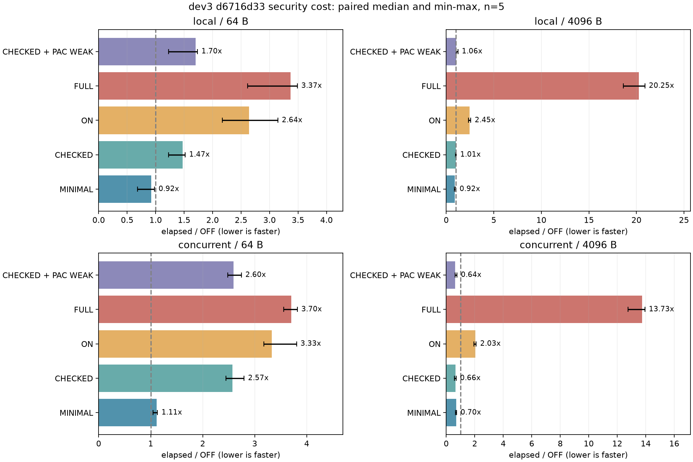

# dev3 보안 모드 성능·메모리 비용

2026-11-06. Experiment: security-20261106-v1. Execution status: Complete.

**보안 모드에 따른 비용 차이는 이번 환경에서 명확히 관찰됐다.**
`ON`은 약 2.0–3.3배, `FULL`은 약 3.4–20.2배의 실행시간이 필요했다.
`CHECKED`는 64 B remote-free에서 약 2.57배였지만 4 KiB에서는 훨씬 작거나
오히려 기본 모드보다 빨랐다. 따라서 보안 설정의 비용을 하나의 비율로 요약하면 안 된다.
이 결과는 같은 커밋 내부의 성능 비교이며 보안 방어 효과를 측정한 결과는 아니다.

## 대상과 환경

- dev3 `d6716d33671c2f621b87be3c7ac016c6ba6b3c94` 한 커밋만 사용.
- AMD Ryzen 7 5700X / x86-64 / WSL2 kernel 6.6.87.2, Rocky Linux 8.9,
  GCC 8.5.0, glibc 2.28. host 부하·주파수는 통제하지 못했다.
- 이미지 `sha256:73353c7a70d01f098f4adc96480273ce5d5b295bea3733c1f2faac2017e05877`.
- Release `-O3 -DNDEBUG`, shared library, 같은 실행파일 + LD_PRELOAD.
  각 모드를 새 디렉터리에서 빌드했고 upstream source는 수정하지 않았다.
- CPU 0,2,4,6,8,10 / NUMA node0, quota 없음, memory 4 GiB, swap 금지,
  network none. host THP madvise 유지. 실제 AnonHugePages도 수집했다.
- fresh process, 조건별 같은 작업량, 반복 안에서 6모드 순서를 무작위화.
  seed 2026110602. 처리 비용은 모드당 5회, lifecycle은 3회.

Design status: Frozen. Frozen at: `2026-11-05T23:57:44.434726+00:00`.
Design revision (계획 문서 SHA-256):
`a67845d9aaa45f5b5d7364824d5535384f63443e38cfdb8e918f4a2c3ad6c8bd`.
[동결 plan](../experiments/security-20261106-v1/plan.json)에 실제 작업량과 hash가 있다.
동결 계획·이전 실험의 소스 및 결과는 보존했다.

## 실제 빌드한 모드

|모드|확인한 secure level|주요 보호 동작|
|---|---:|---|
|OFF|0|기준 Release|
|MINIMAL|1|메타데이터 guard 및 sealed 영역 등 기본 보호|
|CHECKED|2|MINIMAL + free 포인터 검사, free-list 인코딩·무작위화, 재사용 지연|
|ON|4|padding, 해제 시 최대 첫 1 KiB 지우기, 추가 검사와 무작위화|
|FULL|5|ON + allocator page guard, byte 단위 overflow 검사|
|CHECKED + PAC=WEAK|2|CHECKED + 소프트웨어 키를 통한 주요 포인터 인증|

컴파일 flags와 별도 verbose 실행에서 실제 secure level을 검증했다.
마지막 모드만 PAC=WEAK이며 나머지는 PAC=OFF, 전체 MTE=OFF다.
[설정 검증 로그](../experiments/security-20261106-v1/mode-validation.json)와
프로필별 상세 출력은 같은 디렉터리의 `mode-validation/`에 보존했다.
PAC=WEAK는 ARM 하드웨어 PAC와 같은 성능·보호 강도를 의미하지 않는다.

## 처리시간

숫자는 동일 반복끼리의 **모드/OFF elapsed 비율 중앙값**이다. 1보다 크면 더 느리다.
예를 들어 2.57배는 같은 일을 끝내는 시간이 157% 증가한 것이며 처리량은 약 39%다.

|모드|64 B 동일 스레드|4 KiB 동일 스레드|64 B remote-free|4 KiB remote-free|
|---|---:|---:|---:|---:|
|OFF|1.00|1.00|1.00|1.00|
|MINIMAL|0.92|0.92|1.11|0.70|
|CHECKED|1.47|1.01|2.57|0.66|
|ON|2.64|2.45|3.33|2.03|
|FULL|3.37|20.25|3.70|13.73|
|CHECKED + PAC=WEAK|1.70|1.06|2.60|0.64|

오차선은 5회 최소/최대이며 신뢰구간이 아니다. 패널별 가로축 범위가 다르다.
[전체 표](security-20261106/tables.md)는 절대 시간·CPU·RSS와 모든 범위를,
[JSON](security-20261106/summary.json)은 ns/object·fault·THP도 포함한다.

**같은 스레드**는 CPU2에서 1024개를 할당하고 FIFO로 해제하는 새 작은 프로그램이다.
first/last byte를 쓰고 검사하며 100 batch warm-up을 한다. 스레드 생성 비용은 없다.
**remote-free**는 producer-consumer 2쌍, 128 MiB 생존 요청량 상한,
256객체 인계, full write·검증이다. 전체 쓰기와 queue 대기가 포함되므로
두 workload의 절대 시간을 빼서 원격 해제만의 비용을 계산할 수 없다.

관찰 해석:

- ON/FULL의 증가폭은 반복 변동보다 훨씬 컸다. FULL의 4 KiB 동일 스레드
  비율 범위는 18.63–20.89배, remote-free는 12.77–13.94배였다.
- CHECKED는 작은 객체에서 부담이 컸다. 64 B 동일 스레드는 1.23–1.52배,
  remote-free는 2.44–2.80배였다. 4 KiB 동일 스레드는 0.986–1.051배였다.
- MINIMAL/CHECKED의 4 KiB remote-free는 5회 모두 OFF보다 빨랐다.
  OFF 시간은 0.779–0.863초, CHECKED는 0.499–0.547초였다.
  보안 검사뿐 아니라 메타데이터 배치·재사용 정책까지 바뀌는 비교다.
  어떤 변화가 이 개선의 원인인지는 분리하지 않았고 실제 서비스로 일반화하지 않는다.
- MINIMAL은 이 조건들에서 상대 비용이 가장 작았다. 다만 64 B remote-free에서는
  시간 증가가 약 11%여서 '항상 무비용'이라고 표현할 수 없다.

## PAC=WEAK의 추가 비용

OFF 대신 **CHECKED만을 기준**으로 계산하면 다음과 같다.

|조건|CHECKED+PAC=WEAK / CHECKED 중앙값 [최소, 최대]|
|---|---:|
|64 B 동일 스레드|1.142 [0.998, 1.176]|
|4 KiB 동일 스레드|1.065 [1.001, 1.167]|
|64 B remote-free|1.012 [0.967, 1.015]|
|4 KiB remote-free|0.994 [0.923, 1.132]|

동일 스레드에서는 약 6–14% 추가 비용 신호가 있었고, remote-free에서는
작은 차이를 반복 변동과 구분하기 어려웠다. 소프트웨어 포인터 인증을
하드웨어 MTE/PAC의 성능 추정값으로 사용하지 않는다.

## 메모리 비용

별도 lifecycle에서 4 KiB 객체 32768개를 할당하고 모든 바이트를 썼다.
표는 RSS 중앙값이며, 이 workload에서는 해제 후 idle 1초까지 값이 유지됐다.

|모드|128 MiB payload 쓰기 후 RSS|해제 합계 시간 중앙값|
|---|---:|---:|
|OFF|141.50 MiB|1.14 ms|
|MINIMAL|132.02 MiB|0.95 ms|
|CHECKED|132.18 MiB|1.29 ms|
|ON|174.45 MiB|7.64 ms|
|FULL|166.81 MiB|22.53 ms|
|CHECKED + PAC=WEAK|132.14 MiB|1.53 ms|

ON은 OFF보다 RSS 약 33 MiB, FULL은 약 25 MiB 높았다.
별도 untimed `mi_good_size` 조회에서 ON/FULL의 내부 크기 등급은
64 B 요청→80 B, 4096 B 요청→5120 B였으며 나머지는 각각 64/4096 B였다.
padding에 따른 크기 등급 증가가 메모리 비용의 한 요인임을 확인했다.
`mi_good_size`는 size class 진단이며 실측 RSS 전체를 설명하는 값은 아니다.

remote-free의 FULL 4 KiB에서는 peak 약 170 MiB, idle RSS 약 14 MiB였다.
하지만 이 모드는 약 11초 실행되고 OFF는 약 0.8초로 끝난다. 같은 객체 수를
처리해도 purge가 작동할 시간과 재사용 패턴은 다르므로 이 낮은 idle RSS만으로
FULL이 메모리 효율적이라고 결론내리지 않는다. FULL의 해당 조건에서는
idle AnonHugePages가 0이었고 OFF/MINIMAL/CHECKED는 약 116 MiB였다.

`VmHWM`/`ru_maxrss`와 smaps `Rss`는 수집 방식이 달라 소폭의 역전이 있을 수 있다.
peak는 준비·warm-up을 포함한 process lifetime 지표이며 timed region만의 peak가 아니다.
순차 할당·재할당 시간은 일부 모드에서 크게 흔들려 해당 중앙값으로 일반적인 우열을 주장하지 않는다.

## FULL의 큰 비용: 별도 syscall 진단

본 측정이 끝난 뒤, OFF/FULL × 64/4096 B를 `strace -c`로 각 1회 실행했다.
고정 100 warm-up + 100 measured batch, batch당 1024개, 전체 프로세스 기준이다.
진단의 시간은 성능 표에 포함하지 않고 syscall 수만 해석한다.

|4 KiB local 진단|OFF|FULL|
|---|---:|---:|
|mprotect|18|36,882|
|madvise|1|18,438|
|mmap|29|29|

FULL에서는 페이지 보호·반환 관련 호출이 대폭 증가했다. 소스에서도
allocator page의 guard를 설정/해제하는 경로가 확인된다.
이는 FULL의 큰 비용 증가와 부합하는 직접 관찰이지만 전체 20배 중 각 syscall의
기여도를 분해한 것은 아니다. 64 B FULL 진단은 mprotect 32회, madvise 14회로
같은 양상의 폭증이 없었다. 객체 크기에 따라 비용 경로가 다르다.

[진단 원시 결과](../experiments/security-20261106-v1/syscall-diagnostic/results.json) ·
[크기 등급 조회](../experiments/security-20261106-v1/syscall-diagnostic/good-sizes.json).
조회는 프로필당 fresh process의 explicit API이며 LD_PRELOAD 성능 데이터와 분리했다.

## 검증과 한계

본 측정138 + smoke30 + pilot24 = **192 workload 기록 전부 valid**.
별도 실제 모드 확인 6회 및 syscall 진단4회도 통과했다.
라이브러리 버전/경로/hash, checksum·개수·최종 생존량0, affinity,
swap/throttling을 검증했고 성능이 느리다는 이유로 제외한 결과는 없다.
[검증 기록](../experiments/security-20261106-v1/verification.json)에 raw hash를 보존했다.

- 가장 느린 모드의 pilot 속도×12초 상한으로 공통 작업량을 정했다.
  그 결과 OFF/CHECKED 등의 4 KiB 실행이 약 0.5–0.9초로 짧았다.
  FULL의 본 측정은 최대13.16초로 목표를 조금 넘었다. 작은 차이는 신중히 해석한다.
- 이번 세부 조건에서 관찰된 큰 비용과 다른 workload의 성능은 구분해야 한다.
  크기 분포, batch, 생존 객체 수, 재사용률, touch mode가 바뀌면 결과가 달라질 수 있다.
- 5회 탐색 관찰이며 신뢰구간·통계적 동등성·실제 서비스 우열을 주장하지 않는다.
- THP 설정은 같아도 실제 사용은 다르다. host 부하·주파수와 WSL2 스케줄링도 미통제다.
- 보안 공격 탐지율·취약점 방어력, ARM MTE/PAC, p99, perf counter는 미측정이다.
  성능이 낮거나 높다는 사실은 보안상 적합성을 결정하지 않는다.

성능 관점에서는 MINIMAL의 부담이 작았고, CHECKED는 작은 객체 remote-free에서
비용을 확인할 필요가 있다. ON/FULL은 이번 workload에서 큰 비용을 요구했다.
보호 요구가 있는 경우 이 비용과 필요한 보호 기능을 함께 검토해야 한다.

[재현](../observation/SECURITY_20261106.md) · [계획](security-20261106-plan.md) ·
[분석기](../observation/analyze_security_20261106.py).
raw는 `results/security-20261106-v1`, artifact와 실행 로그는
`experiments/security-20261106-v1`, 표/JSON/그림은 `docs/security-20261106`에 보존했다.
