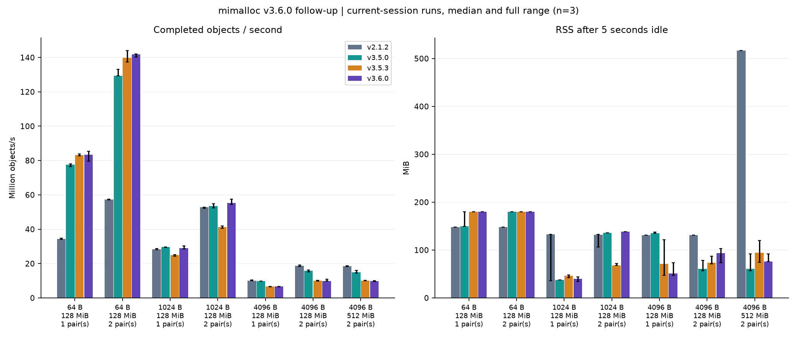
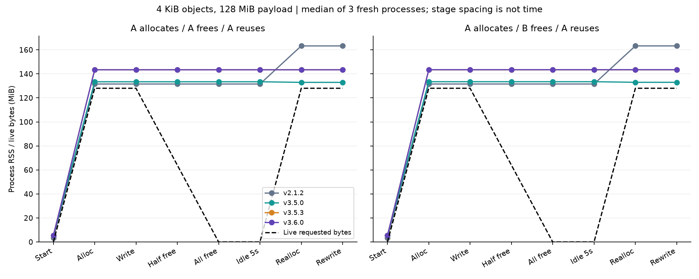

# mimalloc v3.6.0 처리 비용과 메모리 관찰 결과

Date: 2026-10-24. Experiment: release-v360-v1.
Execution status: Complete (211 observed processes including checks and diagnostics).

**v3.6.0은 이번 흐름에서 1 KiB 처리량을 회복했지만, 64 B와 4 KiB에서는 v3.5.3과
큰 차이가 확인되지 않았다. 메모리 사용량이 전반적으로 줄어든 것도 아니다.**
v2.1.2와 v3.5.0을 포함해 네 버전을 같은 날 같은 환경에서 다시 빌드·실행했다.
이 문서의 비교 수치는 모두 이번 실행의 값이다.

## 동시 처리에서 달라진 부분

각 쌍은 할당·전체 쓰기를 수행하는 A와 내용 확인·해제를 수행하는 B로 구성된다.
독립 배치 인계 공간을 사용하며, 아래 단위는 **백만 완료 객체/초**다.
숫자가 클수록 전체 작업 흐름의 처리량이 높다. 개별 malloc/free 속도는 아니다.
표는 3개 fresh process의 중앙값이며 [전체 반복 범위와 CPU·메모리 표](v360/tables.md)를
함께 제공한다.

| 객체 / 공간 상한 / 쌍 | v2.1.2 | v3.5.0 | v3.5.3 | v3.6.0 | 3.6.0 / 3.5.3 변화 |
|---|---:|---:|---:|---:|---:|
| 64 B / 128 MiB / 1 | 34.24 | 77.49 | 83.09 | 83.32 | +0.3% |
| 64 B / 128 MiB / 2 | 57.37 | 129.32 | 139.85 | 141.88 | +1.5% |
| 1 KiB / 128 MiB / 1 | 28.25 | 29.54 | 24.99 | 29.02 | **+16.1%** |
| 1 KiB / 128 MiB / 2 | 52.76 | 53.41 | 41.31 | 55.23 | **+33.7%** |
| 4 KiB / 128 MiB / 1 | 10.11 | 9.77 | 6.59 | 6.73 | +2.1% |
| 4 KiB / 128 MiB / 2 | 18.76 | 15.80 | 10.02 | 9.83 | −1.9% |
| 4 KiB / 512 MiB / 2 | 18.50 | 14.99 | 10.06 | 9.78 | −2.9% |

1 KiB에서는 1쌍과 2쌍 모두 두 버전의 관측 처리량 범위가 겹치지 않았다.
2쌍의 worker CPU 비용도 객체당 71.73 ns에서 60.40 ns로 감소했다.
이 비용에는 인계·대기·쓰기·검증이 포함된다. v3.5.0과 비교하면 1쌍은 약 1.8% 낮고
2쌍은 약 3.4% 높아, 큰 추가 도약보다는 v3.5.3에서 낮아진 처리량의 회복으로 읽힌다.

64 B와 4 KiB는 v3.5.3/v3.6.0 반복 범위가 겹친다. 중앙값의 1~3% 차이를
안정된 개선이나 회귀로 판정하지 않는다. 다만 이는 통계적 동등성을 증명한 것도 아니다.
4 KiB에서 v3.5.0 대비 낮은 처리량은 남아 있으며, 512 MiB 상한에서도 회복되지 않았다.

## 속도가 올라간 조건에서도 메모리를 덜 보유하지는 않았다

1 KiB·2쌍의 종료 후 5초 RSS는 v3.5.3 **68.21 MiB**에서 v3.6.0
**138.20 MiB**로 높아졌다. 각 반복 범위도 각각 68.13~72.32 MiB,
138.18~138.24 MiB였다. 이 조건은 처리량 회복과 더 큰 메모리 보유가 함께 관측됐다.
RSS 차이만으로 속도 향상의 원인을 확정할 수는 없다.

반면 1 KiB·1쌍의 idle RSS 중앙값은 46.20→40.14 MiB였고 범위가 일부 겹쳤다.
따라서 “v3.6.0은 항상 메모리를 더 쓴다”라고 일반화하지 않는다.
4 KiB의 idle RSS도 반복 간 변동이 컸다. 128 MiB·2쌍은 73.30→93.43 MiB,
512 MiB·2쌍은 94.27→76.33 MiB로 중앙값 방향이 달랐고, 두 경우 모두 범위가 겹쳤다.

공간 상한은 실제로 계속 살아 있는 요청량과 다르다. 512 MiB·4 KiB·2쌍의 작업 중
생존량 중앙값은 v3.5.3 약 22 MiB, v3.6.0 약 21 MiB였다. 처음에는 상한까지
채우지만 계속 512 MiB를 보유하는 실험은 아니다. 생존량은 배치 단위 근사 관측이며
0 부근 값도 매 순간 객체가 전혀 없다는 뜻은 아니다.

v2.1.2는 4 KiB에서 가장 높은 처리량을 보였지만 512 MiB 조건에서 idle RSS도
약 516.85 MiB를 보유했다. 같은 조건에서 v3.5.0은 약 60.71 MiB였다.
v2를 포함해야 처리 비용과 메모리 보유 사이의 차이를 함께 볼 수 있다.

## 할당부터 해제 후 재사용까지의 흐름

4 KiB 객체 32,768개, 요청량 128 MiB를 A가 채운 뒤 A 또는 B가 해제하고,
두 스레드를 살려 둔 채 5초 idle 후 A가 재사용했다. 각 조건 3회다.

v3.5.3과 v3.6.0 모두 쓰기 후 RSS 약 **143.4 MiB**를 보였고,
전부 해제 후 5초에도 비슷한 수준을 유지했다. 재사용 시에도 큰 추가 RSS 증가는
없었다. v3.6.0에서 페이지당 4 KiB 객체 **15개**라는 구조가 유지되는 것도
공식 heap visitor로 확인했다. 256개 객체가 18개 영역에 들어갔다.

최초 할당·쓰기 시간은 일부 반복의 변동이 커 안정된 버전 우열을 판단하기 어렵다.
원격 해제 시간 중앙값은 v3.5.3 1.68 ms, v3.6.0 1.45 ms였고, 재할당·쓰기 시간은
24.82 ms와 24.35 ms였다. 같은 스레드 해제 중앙값은 0.98 ms와 1.13 ms였다.
짧은 구간의 결과이며 실제 서비스 지연시간이나 p99로 해석하지 않는다.
RUSAGE_THREAD의 짧은 단계 CPU 시간이 0인 경우는 측정 해상도 한계다.

별도 A collect(true) 진단에서는 v3.5.3/v3.6.0의 RSS가 약 143.4→7.4 MiB로
줄었다. v3.6.0의 이후 재할당·쓰기에는 약 45~47 ms가 걸렸다. 수집 없는 흐름의
약 24~25 ms보다 컸지만, 강제 수집은 조건당 1회이므로 정밀한 효과 크기를 확정하지 않는다.
v2.1.2는 이번 단일 A collect 직후에도 RSS가 유지됐다. 이것만으로 누수를 주장하지 않는다.
idle 관찰은 5초까지이며 30초 이후 반환 여부를 이번 결과로 말하지 않는다.

## 페이지 회수 기본값만으로 설명되는가

[공식 v3.6.0 릴리스 설명](https://github.com/microsoft/mimalloc/blob/v3.6.0/readme.md#releases)은
프로파일링·통계, 캐시 배치, 페이지 회수 정책 등의 변경을 설명한다.
소스에서 `page_reclaim_on_free` 기본값이 0→1로 바뀐 것을 확인했다.
이는 다른 theap에서 온 페이지를 free 경로에서 회수하는 것을 허용한다.
하지만 기본값이 바뀌었다는 사실만으로 이번 성능 차이를 설명하지 않는다.

별도 단일 변수 진단에서 각 버전의 옵션을 0/1로 바꾸며 1 KiB/4 KiB·2쌍·128 MiB를
각 3회 실행했다. 기본 관찰과 별도 바이너리이며 getter 출력만 준비 단계에 추가했다.
동일 버전의 0/1은 동일 바이너리이고, timed workload는 같다. 이 결과는
[전체 표](v360/tables.md)에 별도로 기록한다.

1 KiB의 결과는 다음과 같다. 단위는 백만 완료 객체/초, 중앙값이다.

| 버전 | option=0 | option=1 |
|---|---:|---:|
| v3.5.3 | 40.19 | 41.55 |
| v3.6.0 | 57.47 | 57.88 |

v3.6.0에서 옵션을 0으로 돌려도 높은 처리량은 유지됐고, v3.5.3에서 1로 켜도
v3.6.0 수준으로 올라가지 않았다. v3.6.0의 종료 RSS도 두 옵션에서 약 140.2 MiB로
비슷했다. **이번 1 KiB의 속도 회복과 큰 메모리 보유는 이 기본값 변경 하나로
설명되지 않는다.** v3.6.0 내부의 0/1 처리량 차이는 약 0.7%이며 반복 범위가 겹친다.
4 KiB도 옵션만으로 v3.5.0 수준의 처리량을 회복하지 못했다.

코드에서도 버전별 회수 조건이 달라졌다. v3.6.0 `src/alloc/free.c`는 교차 회수의
여유 공간 조건을 검사하고, 해당하지 않으면 반환하는 명시적 분기가 있다.
따라서 서로 다른 버전에 숫자 0/1을 줬다는 것만으로 내부 정책 전체가 같아지지는 않는다.
또 할당 fast path의 compiler barrier 형태, 통계 필드와 병합 처리 등도 바뀌었다.
현재 관찰은 특정 커밋 하나의 성능 효과를 분리한 실험은 아니다.

## 스레드별 통계 귀속은 그대로다

A malloc 1,000회/B free 1,000회, A free=0/B malloc=0을 유지하고,
두 스레드가 모두 collect한 뒤 아직 parent에 병합하지 않은 값을 읽었다.

| 객체 크기 | 버전 | A 통계의 해제 개수 환산 | B 통계의 해제 개수 환산 | 합계 |
|---|---|---:|---:|---:|
| 64 B | v3.5.3 / v3.6.0 | 1,000 | 0 | 1,000 |
| 4 KiB | v3.5.3 / v3.6.0 | 40 | 960 | 1,000 |

v3.6.0의 새 `free_count`·`freed` 필드를 별도로 읽어도 동일했다.
새 필드명만 보고 호출 스레드별 실적으로 해석하면 안 된다.
`src/alloc/page.c:251`에서 여전히 `last_used + alloc_count - used`로 해제량을
계산하고, 같은 파일 221행에서 선택된 theap의 free_count에 반영한다.
이전 40/960 분리를 만든 페이지당 15개와 full page 보유 기본값 2도 유지된다.

자동 병합 옵션은 바뀌었다. `collect_merges_stats`는 `stats_merge_on_collect`가 되었고,
새 `stats_merge_threshold` 기본값 512 KiB에 도달해도 parent로 병합한다.
스레드 귀속 진단에서는 두 병합을 모두 끄고 getter로 확인했다.
기본 병합을 유지한 실행도 포함했으며 전체 합계는 모든 경우 정확했다.
통계 유실을 발견한 것이 아니며, 호출 스레드별 통계 계약 위반 여부를 확정한 것도 아니다.

## 환경과 검증 범위

- AMD Ryzen 7 5700X, WSL2 kernel 6.6.87.2, Rocky Linux 8.9,
  GCC 8.5.0, glibc 2.28. 고정 이미지 ID는 계획과 artifact manifest에 기록했다.
- CPU 0,2,4,6,8,10, NUMA node 0; 같은 물리 코어의 SMT sibling을 겹치지 않았다.
  quota/memory limit 없음, THP madvise, 측정 컨테이너 network none.
- 모든 버전 Release `-O3 -DNDEBUG`, shared malloc override, secure OFF.
  v3.5.3/v3.6.0 모두 MI_STATS=1, MI_PROFILE=1, MI_DEFAULT_ALLOW_THP=2였다.
  프로파일러의 runtime 활성화 성능은 시험하지 않았다.
- v3.6.0 commit `b18ab4eef383f655e760881b02eff8af02800879`,
  v3.5.3 `d4881d338125e1cb7c47ba4cfb398d6f7c0c8d45`,
  v3.5.0 `18b08671c9302247bfb682286e6bf3cc1773f801`,
  v2.1.2 `43ce4bd7fd34bcc730c1c7471c99995597415488`.
- 본 관찰은 단계별 24회+동시 처리 84회, 별도 collect 8회, smoke 24회,
  pilot 28회, 기존 방식 통계 16회, 새 통계 필드 2회, 구조 진단 1회다.
  옵션 진단은 별도 24회다. payload/identity·체크섬·작업 개수·생존량·allocator 경로와
  버전·library/binary SHA·CPU 배치·swap·throttling을 실행기에 맞춰 검증했다.
  총 211개 관찰 프로세스가 각각의 검증을 통과했고 실패·제외된 관찰은 없다.
  동결 후 작업량·제외 기준·실행 순서는 변경하지 않았다. 추가 진단은 별도 계획으로 기록했다.
- 외부 host 부하·주파수·WSL2 가상화는 통제하지 못했다. 3회 반복의 탐색 결과이며
  통계적 동등성, 모든 크기/응용에서의 우열, mixed-size/장수 객체, NUMA 확장,
  활성 프로파일링 overhead를 확인한 것은 아니다.

[계획](v360-plan.md) · [재현 절차](../observation/RELEASE_V360.md) ·
[집계 JSON](../experiments/release-v360-v1/summary.json) ·
[원자료 hash 목록](../experiments/release-v360-v1/raw-index.json) ·
[빌드·헤더 증거](../experiments/release-v360-v1/build-evidence.json).
