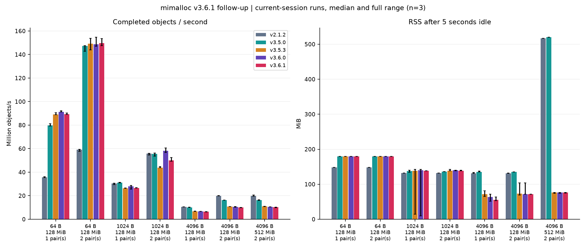
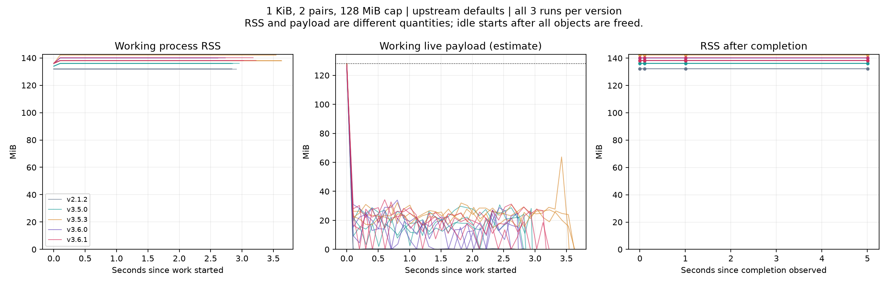
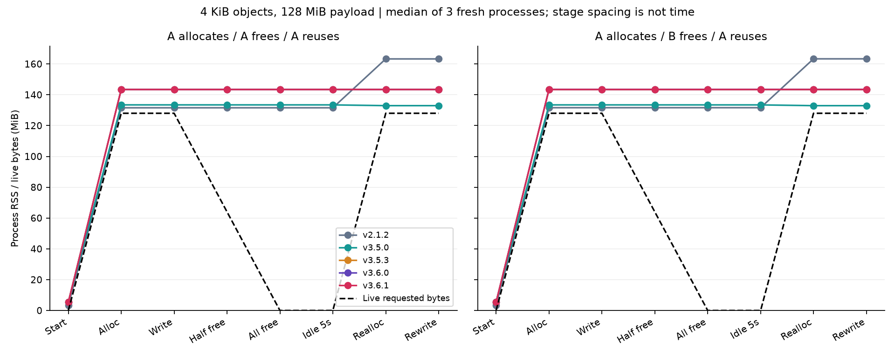
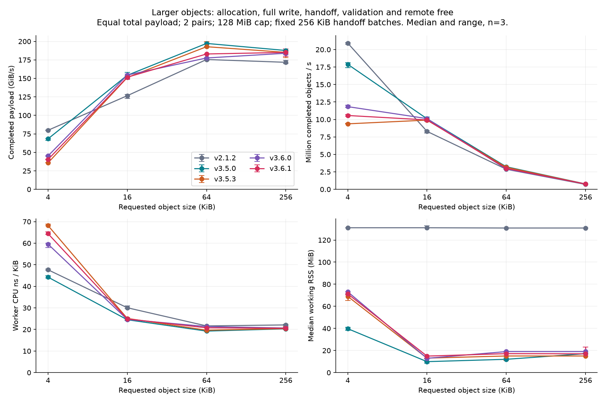

# mimalloc v3.6.1 처리 비용과 메모리 비교

2026-10-31. Execution status: Complete. Design status: Frozen.

식별자: release-v361-v1 / purge-delay-v361-v1 / allocation-size-v361-v1.

기본 계획 동결 시각(UTC): 2026-10-31T01:16:26.064748+00:00.

Design revision (plan SHA-256): `5c6a1f85aadaa6e7b3ea7823b1f5bed40038e19ffd04bc712ac97aa377e2d9b1`.

## 주요 발견과 판단

이번 조건에서 v3.6.1은 v3.6.0 대비 일괄적인 처리량 개선을 보이지 않았다. 기본 1 KiB·2쌍 처리량은 58.07→49.96 M객체/s, 14.0% 감소했고 idle RSS 중앙값은 140.16→138.33 MiB였다. 속도 저하와 함께 큰 메모리 절감이 나타난 조건은 아니다.

기본 4 KiB 조건에서 v3.6.1의 처리량 중앙값은 약 4–6% 낮았다. 별도 동일 바이트/256 KiB 인계 비교에서는 4 KiB가 약 11% 낮았고, 16/64/256 KiB 차이는 각각 약 -2%/+3%/+1%였다. 서로 다른 배치와 정책의 수치를 합치지 않는다.

v3.6.1 안에서 4→16/64 KiB로 묶으면 완료 바이트 처리량이 각각 3.76/4.54배였다. 64→256 KiB의 추가 이득은 작고 반복 범위가 겹쳤다. 이 효과에는 객체 수 감소·쓰기·큐 전달·실제 생존량 차이가 포함된다.

purge delay1000/mult1에서는 v3.6.1의 idle RSS 중앙값이 더 낮았지만 작업 중 RSS는 비슷했다. 종료 시점이 반환 주기의 어느 위치인지도 영향을 주므로 idle 값만으로 전반적인 메모리 효율 개선을 주장하지 않는다.

성능만을 이유로 v3.6.0에서 일괄 전환할 근거는 이번 관찰에서 부족하다. 전환 검증에서는 1 KiB·2쌍과 4 KiB 흐름을 우선 회귀 조건으로 삼는 것이 적절하다. 기능 수정의 필요성은 실제 사용 API와 별도로 판단해야 한다. 원인 분리가 필요하면 page_reclaim_on_free와 stats_merge_threshold를 각각 통제하는 새 진단이 다음 단계이며, 이번 보고서의 완료 범위에는 포함하지 않는다.

## 범위와 읽는 법

v2.1.2/v3.5.0/v3.5.3/v3.6.0/v3.6.1을 같은 환경에서 새로 빌드하고 측정했다. 과거 측정값을 새 표본에 섞지 않았다. 각 본 측정 조건은 3회이며 표는 중앙값 [최소–최대]다. 처리량은 할당·전체 쓰기·인계·내용 확인·해제를 합친 비용이다.

기본 동시 처리 105회, lifecycle 30회, 강제 collect 진단 10회, stats 24회, purge 본 측정 30회, 크기 본 측정 60회를 완료했다. smoke/default 검증 65회와 pilot 55회도 완료했다. 총 379개 fresh-process 관찰이며 invalid/excluded는 0이다.

## 환경과 소스

AMD Ryzen 7 5700X, 8코어/16 논리 CPU, WSL2 Linux 6.6.87.2, Rocky Linux 8.9, GCC 8.5.0, glibc 2.28. 컨테이너 cpuset 0,2,4,6,8,10, NUMA node 0, CPU quota와 memory limit은 max, network none. 빌드 시 VM 메모리 약 31.3 GiB, available 약 29.5 GiB. THP는 madvise, HugeTLB 예약은 0이다.

고정 이미지: `sha256:73353c7a70d01f098f4adc96480273ce5d5b295bea3733c1f2faac2017e05877`. Release -O3 -DNDEBUG, MI_SECURE=OFF. 실제 로드 버전·경로·SHA를 매 실행 검증했다.

v3.6.1 commit: `56dc5eb80145f9a3ba7ca23d47c6a248b9d8586c`. 전체 소스 SHA·명령·CMake cache·library/header hash는 [빌드 기록](../experiments/release-v361-v1/lifecycle/artifacts.json)과 [소스 기록](../experiments/release-v361-v1/sources.json)에 있다.

## v3.6.0과의 기본 동작 비교

처리량 비율은 v3.6.1/v3.6.0으로 1보다 크면 이 흐름에서 더 빠르다. 범위 비중첩은 기술적 관찰이며 유의성 검정이 아니다. RSS는 작업 종료 후 worker를 살려 둔 5초 시점이다.

| 객체 / 상한 / 쌍 | v3.6.0 M객체/s | v3.6.1 M객체/s | 비율 | v3.6.0 idle MiB | v3.6.1 idle MiB |
|---|---:|---:|---:|---:|---:|
| 64 B / 128 MiB / 1 | 91.24 [91.13–92.11] | 89.39 [88.98–90.32] | 0.980 | 179.69 [179.62–179.72] | 179.63 [179.54–179.68] |
| 64 B / 128 MiB / 2 | 148.84 [147.03–154.78] | 149.70 [147.44–153.59] | 1.006 | 179.70 [179.54–179.73] | 179.65 [179.64–179.73] |
| 1024 B / 128 MiB / 1 | 27.98 [25.56–28.76] | 26.55 [26.48–26.74] | 0.949 | 140.21 [9.45–142.25] | 138.16 [138.07–138.20] |
| 1024 B / 128 MiB / 2 | 58.07 [56.74–60.69] | 49.96 [49.24–52.51] | 0.860 | 140.16 [138.18–140.18] | 138.33 [138.18–140.27] |
| 4096 B / 128 MiB / 1 | 6.74 [6.68–6.81] | 6.47 [6.31–6.54] | 0.961 | 63.44 [51.48–71.39] | 55.48 [53.48–63.43] |
| 4096 B / 128 MiB / 2 | 10.58 [10.29–10.72] | 9.93 [9.72–10.05] | 0.939 | 71.50 [71.40–103.41] | 71.42 [71.41–71.46] |
| 4096 B / 512 MiB / 2 | 10.58 [10.44–10.63] | 10.20 [9.75–10.33] | 0.964 | 76.23 [74.26–76.32] | 76.23 [74.87–76.29] |

전체 다섯 버전의 CPU 비용·생존량·RSS와 단계별 수치는 [전체 표](v361/tables.md)에 있다. 공간 상한은 실제 생존량이나 RSS와 같지 않다.

## 동일 스레드/다른 스레드 해제

4 KiB × 32768개, 128 MiB를 할당·쓰기·절반/전체 해제·5초 idle·재사용했다. same은 A 할당/A 해제, remote는 A 할당/B 해제이며 재사용은 A가 한다.

| 버전 | 해제 | 최초 할당+쓰기 ms | 해제 ms | 재할당+쓰기 ms | 5초 RSS MiB |
|---|---|---:|---:|---:|---:|
| v3.6.0 | remote | 28.02 [21.55–63.47] | 1.48 [1.46–1.66] | 25.22 [24.35–26.06] | 143.49 [143.40–143.50] |
| v3.6.1 | remote | 22.65 [20.90–52.01] | 1.29 [1.25–1.42] | 25.28 [24.69–28.17] | 143.43 [143.42–143.44] |
| v3.6.0 | same | 22.36 [21.56–52.86] | 1.12 [1.09–1.14] | 26.85 [25.30–29.27] | 143.45 [143.40–143.48] |
| v3.6.1 | same | 22.57 [21.59–67.40] | 1.07 [1.06–1.11] | 25.94 [24.70–30.05] | 143.42 [143.40–143.48] |

강제 collect는 별도 1회 진단이다. idle과 섞지 않으며 [전체 표](v361/tables.md)에 전후 RSS와 재사용 비용을 기록했다.

## purge 대기시간 비교

1 KiB, 2쌍, 128 MiB 상한. delay 10/1000 ms, arena_purge_mult=1. 다른 정책은 각 버전 기본값이므로 완전한 동일 정책 비교가 아니다.

| delay ms | 버전 | M객체/s | 작업 중 RSS MiB | idle 5초 RSS MiB |
|---:|---|---:|---:|---:|
| 10 | v3.6.0 | 70.61 [64.19–71.69] | 19.34 [19.27–70.02] | 23.44 [17.43–72.18] |
| 10 | v3.6.1 | 67.86 [59.22–69.98] | 20.34 [11.93–72.14] | 23.00 [15.15–76.26] |
| 1000 | v3.6.0 | 55.58 [53.17–56.07] | 70.02 [52.02–72.99] | 74.18 [42.24–74.19] |
| 1000 | v3.6.1 | 50.30 [48.30–51.00] | 71.96 [70.15–74.02] | 43.67 [27.28–43.77] |

[다섯 버전 purge 전체 표](purge-delay-v361/tables.md). 작업 중 RSS는 각 실행의 10–90% 시간대 샘플 중앙값을 다시 3회 요약한 것이다.

## 할당 크기 비교

2쌍, 128 MiB 상한, 256 KiB 인계 배치, delay1000/mult1. 모든 크기/버전에서 완료 payload 742.625 GiB를 동일하게 처리했다. 초기 128 MiB는 timed 쓰기 밖에 있다. GiB/s는 완료 요청 바이트 기준이며 DRAM 대역폭 계측값이 아니다.

| 객체 KiB | v3.6.0 GiB/s | v3.6.1 GiB/s | 비율 | v3.6.1 작업 중 RSS MiB |
|---:|---:|---:|---:|---:|
| 4 | 45.14 [44.64–45.94] | 40.30 [39.98–40.79] | 0.893 | 71.27 [70.46–73.27] |
| 16 | 154.45 [148.41–155.84] | 151.55 [150.59–153.73] | 0.981 | 14.95 [13.00–15.07] |
| 64 | 177.57 [175.90–177.70] | 182.97 [182.60–182.98] | 1.030 | 17.16 [15.16–18.16] |
| 256 | 183.96 [182.34–187.16] | 185.11 [179.92–189.71] | 1.006 | 17.03 [15.03–23.03] |

[다섯 버전 크기 전체 표](allocation-size-v361/tables.md).

## 통계 진단과 소스 해석

A가 1000개를 할당하고 B가 모두 해제한 진단에서 전체 최종 current는 0이었다. 자동 병합을 끄고 collect를 반복한 시점에서 64 B의 파생 해제량은 A에 64000 B, B에 0 B로 귀속되었다. 4 KiB는 A에 163840 B, B에 3932160 B로 나뉘었다. 이 패턴은 v3.5.3/v3.6.0/v3.6.1에서 같았다. 파생 해제량은 실제 free 호출 횟수가 아니다.

v3.6.1 기본 page_reclaim_on_free는 0, 통계 병합 임계값은 4 MiB다. v3.6.0의 1, 512 KiB와 다르며 pagemap/process 상태도 바뀌었다. 이번 비교만으로 각 변경의 개별 인과 효과는 분리하지 않았다. [소스 근거](v361-source-notes.md)를 참고한다.

## 검증과 한계

모든 본 측정은 frozen hash, library/binary SHA, 버전/경로, 객체 수·checksum·최종 생존량, CPU 배치, swap/throttling을 검증했다. 실패한 측정을 삭제하거나 제외하지 않았다. 준비 중 runner 생성의 문자열 검증이 한 차례 중단됐으며 측정 전에 수정했다. 이는 allocator 실패나 제외 표본이 아니다.

분석 출력에서 Windows cp949 인코딩 오류가 발생해 콘솔 출력을 ASCII 요약으로 수정하고 분석을 재실행했다. Windows Git의 실행 비트 표시 차이는 내용 검증과 구분했다. 컨테이너 빌드 시에는 원본 checkout이 clean인지 검증했으며 upstream 내용을 수정하지 않았다.

실제 동시 처리 본 측정 시간은 2.214–20.791초, 전체 관찰의 프로세스 peak RSS는 556.20 MiB였다. 동시 처리 본 측정의 major fault 합계는 0이다. pilot 목표 3.5초보다 짧은 실행도 있으며 작업량을 사후 변경하지 않았다.

3회 반복, WSL2 가상화, 미통제 host 부하·주파수 때문에 작은 차이의 유의성이나 동등성을 주장하지 않는다. p99, perf cycles/instructions, 실제 응용 성능, CPython/fork/Rust/WASI 기능, MI_SECURE=MINIMAL, 정책별 인과 대조는 이번 범위에 포함하지 않았다. RSS 잔류만으로 누수라 판단하지 않으며 idle 이후 관측하지 않은 반환 시점을 추정하지 않는다.

## 재현과 자료

[계획](v361-plan.md) · [재현 명령](../observation/RELEASE_V361.md) · [검증 상태](../experiments/release-v361-v1/status.json).

원자료는 results/release-v361-v1, results/purge-delay-v361-v1, results/allocation-size-v361-v1에 보존한다. 각 experiments 디렉터리에 plan, artifacts, summary와 raw-index를 보존하며 figures는 docs의 대응 디렉터리에 있다.
