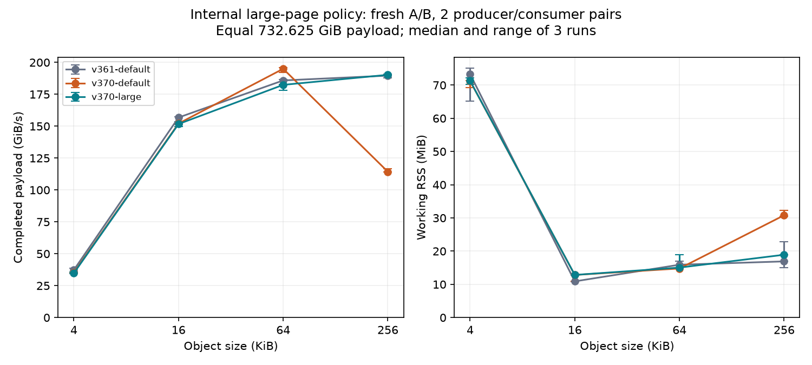

# v3.7.0 large page ON 결과

Execution status: Complete. Namespace: `v370-large-pages-v1`.

**256 KiB 회귀는 MI_ENABLE_LARGE_PAGES=1로 회복됐다.** 같은 v3.7.0 기본값 대비
처리량이66.5% 증가했고, 새로 측정한 v3.6.1과는+0.34%로 비슷했다.
이는 앞선 코드 분석에서 지목한 내부 large-page 정책 변경이 이 workload의 주요
회귀 요인이라는 강한 A/B 근거다. 64 KiB는 반대로6.5% 느려졌다.
4·16 KiB 저하는 이 설정으로 해결되지 않았다.

## 동일 세션에서 새로 측정한 비교

처리량 GiB/s, 각3회 중앙값. 모든 셀의 완료 payload732.625 GiB.
아래 값은 과거 측정값과 합치지 않은 이번36회 측정만의 결과다.

| 객체 | v3.6.1 기본 | v3.7.0 기본 | v3.7.0 large ON | ON/기본 변화 |
|---|---:|---:|---:|---:|
| 4 KiB | 37.30 | 35.30 | 34.78 | -1.5% |
| 16 KiB | 156.80 | 152.07 | 151.68 | -0.3% |
| 64 KiB | 185.87 | 194.97 | 182.39 | -6.5% |
| 256 KiB | 189.63 | 114.29 | 190.27 | +66.5% |

256 KiB 기본의 범위는114.20–116.72, ON은189.43–190.53 GiB/s로 겹치지 않는다.
64 KiB도 기본191.91–195.89와 ON178.19–182.62의 범위가 겹치지 않는다.
4·16 KiB의 ON/OFF 범위는 겹친다. 3회 탐색 관찰로 통계적 유의성을 주장하지 않는다.



## 메모리와 CPU

256 KiB의 작업 중 RSS 중앙값은30.80→18.91 MiB(-38.6%)로 감소했다.
v3.6.1은16.91 MiB였다. minor fault는2,785→11로 감소했고,
producer CPU는4,261→2,562 ns/완료객체, consumer는4,268→2,563으로 줄었다.
CPU에는 allocator 외에 쓰기·검증·spin 대기가 포함되므로 함수별 비용으로 해석하지 않는다.

64 KiB는 RSS14.78→15.04 MiB, minor fault1,028→11이었다.
fault 감소와 처리량 향상은 동일하지 않다. 4 KiB의 RSS는71.22→71.28 MiB로 유사했다.
RSS/생존량은 각 실행10–90% 시간대 샘플 중앙값을 다시3회 요약한 것이다.
큰 객체의 생존량 근사값0은 샘플 시점의 진행량 카운터 차이이며 실제 live 객체가 항상0이라는 뜻이 아니다.
GiB/s는 완료 payload 지표이며 DRAM 대역폭 실측이 아니다.

전체 범위·CPU·fault·idle RSS는 [상세 표](../experiments/v370-large-pages-v1/tables.md),
기계 판독용 값은 [summary.json](../experiments/v370-large-pages-v1/summary.json)에 있다.

## 코드 가설과 연결

컴파일된 매크로와 실제 단일 할당의 페이지 배치를 별도 probe로 확인했다.

| 객체 | v3.7.0 기본 | large ON |
|---|---|---|
| 4 KiB | 64 KiB 영역, reserved15, 최초capacity1 | 동일 |
| 16 KiB | 512 KiB 영역, reserved31 | 동일 |
| 64 KiB | 512 KiB 영역, reserved7 | 4 MiB 영역, reserved63 |
| 256 KiB | 320 KiB singleton, reserved1 | 4 MiB 영역, reserved15 |

reserved는 담을 수 있는 블록 수이며 실제 사용량·RSS가 아니다. probe는 주 측정과 분리했다.
256 KiB가 단일 객체마다 페이지를 처리하는 경로에서 여러 객체에 페이지 비용을
나눠 부담하는 경로로 돌아간다는 설명과, 처리량·CPU·fault 회복이 함께 맞아떨어진다.
다만 이 매크로는 MI_MAX_RECLAIM_OBJ_SIZE 등 파생 정책과 코드 배치도 함께 바꾸므로,
한 함수 또는 한 명령어의 기여율까지 분해한 실험은 아니다.

4 KiB cookie 검사와 free-list 확장 변경은 그대로다. 따라서 이것들이 원인이라는
추가 증명은 아니지만, large-page 정책만으로 4 KiB 저하를 설명하기 어렵다는 점은 확인했다.
64 KiB가 중요하면 기본값의 성능 이점이 있으므로 모든 workload에 ON을 권장할 수는 없다.
이 결과는2쌍 remote-free·full-write·특정 purge 정책에 한정된다.

## 빌드·실행·검증

- v3.6.1: `56dc5eb80145f9a3ba7ca23d47c6a248b9d8586c`.
- v3.7.0: `1ed67b5156a763441d2ec3c20221a7b3cd866129`.
- 세 빌드 모두 별도 새 경로. upstream 소스 변경 없음. Release `-O3 -DNDEBUG`, MI_SECURE=OFF.
- ON 빌드에만 CMake 인수 `-DCMAKE_C_FLAGS=-DMI_ENABLE_LARGE_PAGES=1` 추가.
  이는 내부 매크로를 C compiler에 전달한 것이며 같은 이름의 CMake 옵션을 가정하지 않았다.
- 고정 Rocky8 이미지 `sha256:73353c7a70d01f098f4adc96480273ce5d5b295bea3733c1f2faac2017e05877`.
  Ryzen7 5700X, WSL2, GCC8.5, glibc2.28. THP는 기존 madvise 그대로이며 OS large pages를 켠 실험이 아니다.
- 동일 동결 workload 바이너리를 복사·해시 확인, LD_PRELOAD로 교체.
  2쌍, cap128 MiB, handoff256 KiB, purge_delay1000, arena_purge_mult1.
- cpuset0,2,4,6,8,10 / node0, memory6 GiB, swap 없음, CPU quota 없음, network none.
- smoke12 + pilot12 후 계획 동결, 반복별12셀 무작위화(seed2026111804), measured36.
  측정3.740–21.261초. invalid0, 제외0, major fault0.
- 별도 분석기가 allocator/library/binary 해시, 결과 개수·checksum, CPU 배치,
  cgroup·swap·throttling 및 계획 순서를 다시 검사했다. 과거 동결 입력도 보존됐다.
- 최초 준비에서 manifest 경로 정규화 오류를 수정하고 준비를 다시 실행했다.
  smoke/pilot/동결/측정은 모두 그 이후이며 측정 결과 제외나 사후 설계 변경은 없었다.

동결 시각: `2026-11-18T01:30:23.202115+00:00`.
plan SHA256: `866d2f71bc0d7316114e07e852aeb7ce930b74d9868266082a78b47ab6ca6e74`.
[계획](v370-large-pages-plan.md), [실행 계약](../experiments/v370-large-pages-v1/plan.json),
[빌드/환경](../experiments/v370-large-pages-v1/artifacts.json),
[페이지 배치](../experiments/v370-large-pages-v1/pages.json),
[검증 상태](../experiments/v370-large-pages-v1/status.json),
[raw 해시 목록](../experiments/v370-large-pages-v1/raw-index.json).
원시 데이터: `results/v370-large-pages-v1/{smoke,pilot,measured}`.

새 namespace의 빈 출력 경로에서 실행하는 재현 진입점:

```powershell
.\observation\run_v370_large_pages.ps1
python observation/analyze_v370_large_pages.py
```

실행기는 기존 측정 결과를 덮어쓰지 않는다. 현재 완료된 namespace에서는 분석만 재실행할 수 있다.
재측정은 별도 namespace로 복사해 진행한다. 분석 스크립트는 로컬 Python의 matplotlib/numpy를 사용한다.
