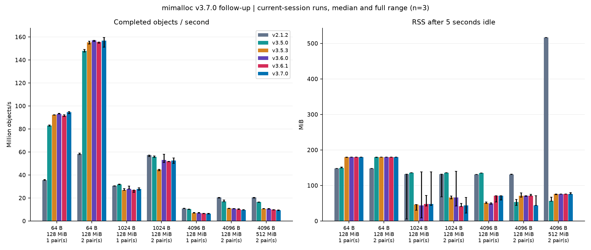
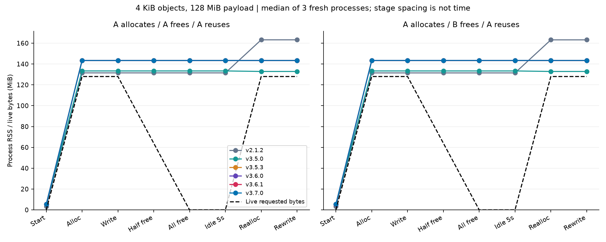
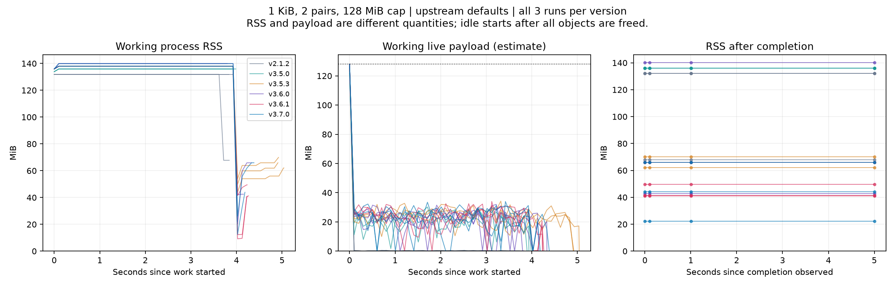
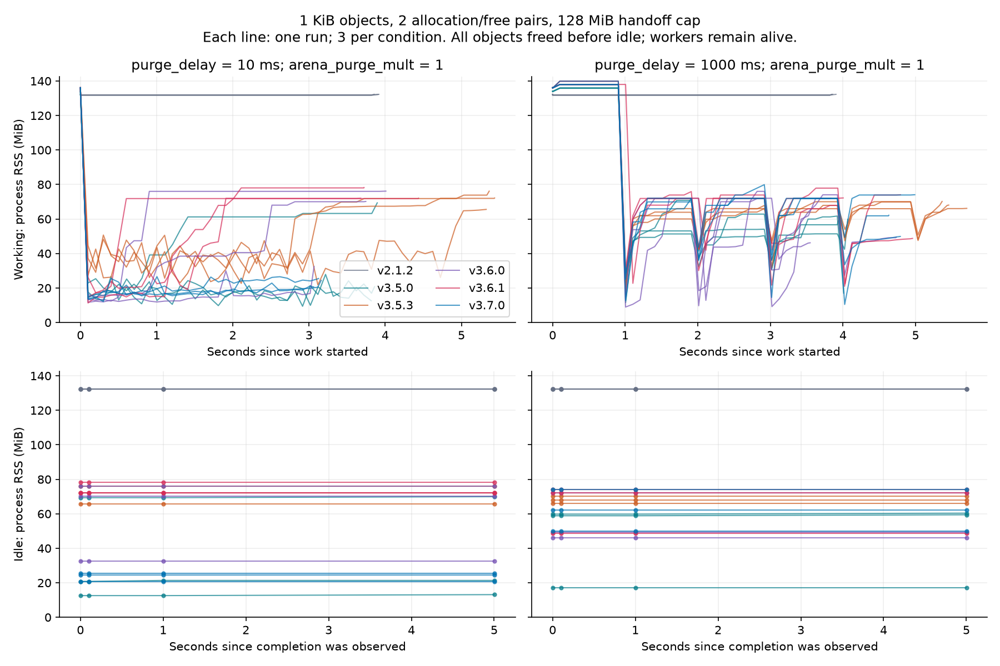
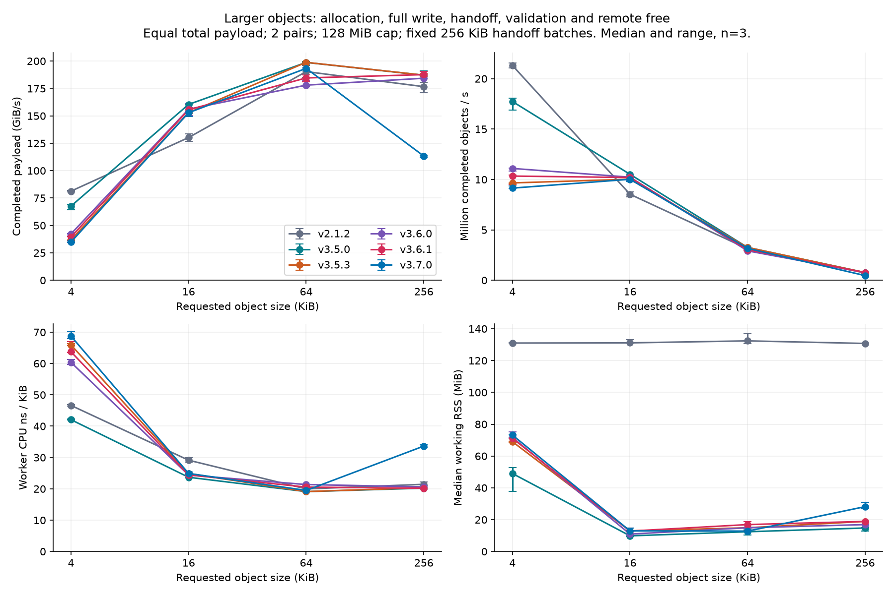

# mimalloc v3.7.0 처리 비용과 메모리 비교

2026-11-18. Execution status: Complete. Design status: Frozen.
식별자: release-v370-v1 / purge-delay-v370-v1 / allocation-size-v370-v1.
Frozen at (UTC): 2026-11-17T23:04:55.224438+00:00
Design revision (plan SHA-256): `961b15f3867286fc0fcbf7539ffc8d57021f5cc62754208de51075745dbe3277`.

## 주요 관찰

v3.7.0이 모든 조건에서 개선되지는 않았다. 기본 4 KiB·2쌍 처리량 중앙값은 v3.6.1 대비 128 MiB 상한에서 -4.7%, 512 MiB 상한에서 -6.8%였다. 세 반복에서는 두 조건 모두 v3.7.0의 처리 시간이 더 긴 범위에 있었다. 이 조건을 업그레이드 시 우선 회귀 점검 대상으로 삼는다.

반면 1 KiB·2쌍, purge_delay=10 ms, arena_purge_mult=1에서는 5초 RSS 중앙값이 72.05→24.44 MiB였다. 작업 중 생존량 추정 중앙값도 21.50→0.12 MiB로 달랐다. 기본 정책과 다른 결과이며, RSS 차이를 순수 반환 효율 개선이나 purge 수정 단독 효과로 해석하지 않는다.

수명 관찰에서는 두 버전 모두 128 MiB payload를 해제한 뒤에도 약143 MiB RSS가 5초간 유지됐다. 통계 API의 해제량 귀속도 두 버전에서 같은 패턴이었다. 따라서 메모리 반환·스레드 통계가 전반적으로 달라졌다고 볼 수는 없다.

같은 총 바이트·256 KiB 인계 배치의 별도 크기 비교에서 4 KiB 처리량 변화는 -11.6%였다. 기본 비교와 배치·purge 정책이 다르므로 수치를 합치지 않는다.

같은 크기 비교의 256 KiB에서는 187.64→113.34 GiB/s, -39.6%였다. 이 조건도 우선 회귀 점검 대상으로 삼는다. 작업 중 RSS 중앙값은 18.90→28.20 MiB였다.

각 조건3회의 탐색 관찰이다. 배포 판단에는 실제 응용의 객체 크기·수명·해제 스레드 구성과 기능 수정 필요성을 함께 고려해야 한다.

## 범위와 판정

기존 다섯 릴리스에 v3.7.0을 추가해 여섯 버전을 모두 새로 빌드·측정했다. 과거 표본은 합치지 않았다. 기본 조건당 3회이며 수치는 중앙값 [최소–최대]다. 작은 차이의 통계적 유의성·동등성이나 실제 응용의 우열을 판정하지 않는다.
처리량은 할당·전체 쓰기·큐 인계·양끝 내용 확인·해제·대기를 포함한다. smoke는 전체 payload를 확인한다. 순수 malloc/free 호출 비용이나 DRAM 대역폭 수치가 아니다.
총 458개 fresh-process 기록을 검증했다. invalid=0, excluded=0. 기본 동시 처리126, lifecycle36, 강제 collect12, stats32, purge36, 크기72회이며 나머지는 smoke/default78, pilot66회다.

## 직전 릴리스 대비 기본 동시 처리

변화율은 v3.7.0 / v3.6.1 처리량 중앙값 − 1이다. 양수면 처리량 증가다. RSS는 객체 해제가 끝난 뒤 5초 값이며 생존 요청량과 다르다.

| 크기 B | 상한 MiB | 쌍 | v3.6.1 M객체/s | v3.7.0 M객체/s | 변화 | v3.6.1 idle RSS MiB | v3.7.0 idle RSS MiB |
|---:|---:|---:|---:|---:|---:|---:|---:|
| 64 | 128 | 1 | 91.70 [90.93–92.32] | 94.51 [93.24–95.03] | +3.1% | 179.50 [179.50–179.61] | 179.61 [179.59–179.70] |
| 64 | 128 | 2 | 155.57 [154.67–155.65] | 156.70 [151.05–159.58] | +0.7% | 179.62 [179.58–179.62] | 179.56 [179.53–179.60] |
| 1024 | 128 | 1 | 26.78 [24.83–26.91] | 27.90 [26.78–28.95] | +4.2% | 48.15 [42.14–72.09] | 48.18 [44.08–138.07] |
| 1024 | 128 | 2 | 51.91 [51.59–51.96] | 52.57 [50.19–54.77] | +1.3% | 41.37 [40.98–49.61] | 44.09 [22.32–66.09] |
| 4096 | 128 | 1 | 6.60 [6.51–6.75] | 6.48 [6.20–6.58] | -1.9% | 71.26 [53.28–71.36] | 71.36 [59.27–71.45] |
| 4096 | 128 | 2 | 10.08 [10.07–10.50] | 9.61 [9.57–9.92] | -4.7% | 71.29 [71.27–75.38] | 44.12 [44.04–71.38] |
| 4096 | 512 | 2 | 9.92 [9.73–9.94] | 9.25 [9.21–9.55] | -6.8% | 76.10 [76.09–76.11] | 76.17 [76.17–80.20] |

[여섯 버전 전체 수치](v370/tables.md). 반복 범위가 겹치는 차이는 확정적인 개선·회귀로 해석하지 않는다. 버전 비교만으로 purge 수정, 보안 내부 구조, 통계 경로 각각의 인과 효과를 분리할 수 없다.

## 기준 버전별 처리량 비율

v3.7.0 중앙값 / 각 기준 버전 중앙값. 동일 환경·동일 작업량의 이번 실행만 사용한다.

| 크기 B | 상한 MiB | 쌍 | /v2.1.2 | /v3.5.0 | /v3.5.3 | /v3.6.0 | /v3.6.1 |
|---:|---:|---:|---:|---:|---:|---:|---:|
| 64 | 128 | 1 | 2.653 | 1.139 | 1.025 | 1.014 | 1.031 |
| 64 | 128 | 2 | 2.694 | 1.060 | 1.009 | 0.997 | 1.007 |
| 1024 | 128 | 1 | 0.914 | 0.879 | 1.036 | 0.999 | 1.042 |
| 1024 | 128 | 2 | 0.918 | 0.941 | 1.176 | 0.992 | 1.013 |
| 4096 | 128 | 1 | 0.603 | 0.625 | 0.932 | 0.925 | 0.981 |
| 4096 | 128 | 2 | 0.472 | 0.566 | 0.872 | 0.894 | 0.953 |
| 4096 | 512 | 2 | 0.453 | 0.560 | 0.864 | 0.870 | 0.932 |

## 동일/다른 스레드 해제와 메모리 수명

4 KiB × 32768개, 요청량128 MiB. A가 할당·쓰기하고 A 또는 B가 해제한 뒤 A가 새로 할당한다. 이 재할당 단계는 realloc API가 아니다. 강제 collect는 별도 조건당 1회 진단이다.

| 해제 담당 | 버전 | 해제 ms | 쓰기 후 RSS MiB | 전부 해제 후 5초 RSS MiB | 재할당+쓰기 ms |
|---|---|---:|---:|---:|---:|
| remote | v3.6.1 | 1.21 [1.18–1.23] | 143.32 [143.32–143.41] | 143.32 [143.32–143.41] | 23.68 [21.48–24.37] |
| remote | v3.7.0 | 1.20 [1.20–1.29] | 143.39 [143.35–143.39] | 143.39 [143.35–143.39] | 23.64 [23.12–24.00] |
| same | v3.6.1 | 1.09 [1.05–1.13] | 143.41 [143.41–143.42] | 143.41 [143.41–143.42] | 24.65 [23.71–24.80] |
| same | v3.7.0 | 1.11 [1.05–1.13] | 143.39 [143.32–143.43] | 143.39 [143.32–143.43] | 23.93 [23.69–24.69] |

RSS 잔류만으로 누수를 판단할 수 없다. 관찰 시 worker는 살아 있고 idle만으로 purge가 반드시 실행되지는 않는다. 진행 카운터의 생존량은 비동기 샘플의 추정치다.

## purge 대기시간 정렬

1 KiB, 2쌍, 128 MiB 상한. purge_delay=10/1000 ms와 arena_purge_mult=1만 정렬했다. 완전히 동일한 정책 또는 purge 수정 단독 효과 비교가 아니다.

| delay ms | 버전 | 작업 중 RSS MiB | 완료 RSS MiB | 5초 RSS MiB | M객체/s |
|---:|---|---:|---:|---:|---:|
| 10 | v3.6.1 | 67.89 [59.37–71.84] | 72.05 [72.02–78.21] | 72.05 [72.02–78.21] | 59.10 [49.57–59.80] |
| 10 | v3.7.0 | 18.03 [17.84–21.40] | 24.44 [20.59–25.49] | 24.44 [20.59–25.49] | 70.39 [69.61–71.87] |
| 1000 | v3.6.1 | 71.89 [67.90–72.02] | 72.21 [48.75–74.04] | 72.21 [48.75–74.04] | 45.91 [44.37–54.95] |
| 1000 | v3.7.0 | 71.90 [70.88–72.00] | 62.16 [49.89–74.06] | 62.16 [49.89–74.06] | 45.93 [44.09–47.50] |

[purge 전체 수치](purge-delay-v370/tables.md).

## 동일 총 바이트의 할당 크기 비교

모든 조건 732.625 GiB, 2쌍, 128 MiB 상한, 256 KiB 인계 배치, delay1000/mult1. 처음 준비 적재한 0.125 GiB의 쓰기는 timed region 밖이다.

| 객체 KiB | v3.6.1 GiB/s | v3.7.0 GiB/s | 변화 | v3.6.1 작업 중 RSS MiB | v3.7.0 작업 중 RSS MiB |
|---:|---:|---:|---:|---:|---:|
| 4 | 39.44 [36.35–39.87] | 34.88 [34.68–35.66] | -11.6% | 71.15 [71.14–73.46] | 73.16 [71.59–73.28] |
| 16 | 155.57 [153.80–157.51] | 152.91 [149.39–154.12] | -1.7% | 12.82 [12.81–14.81] | 12.95 [10.94–14.82] |
| 64 | 184.62 [180.92–187.54] | 193.33 [192.49–196.43] | +4.7% | 16.91 [14.91–18.91] | 12.81 [12.71–14.74] |
| 256 | 187.64 [185.56–190.41] | 113.34 [111.81–113.94] | -39.6% | 18.90 [16.90–18.91] | 28.20 [26.80–31.01] |

[크기 전체 수치](allocation-size-v370/tables.md).

## 통계 API 진단

각 조건2회. A가1000개 할당하고 B가 해제한 실제 호출 수와 allocator 통계의 귀속을 구분한다. 최종 합계 current_bytes=0을 검증했다. 아래는 첫 반복의 명시적 collect 후 값이며 전체 반복은 summary.json에 있다.

| 버전 | 객체 B | 자동 병합 | A 귀속 해제 B | B 귀속 해제 B | parent 귀속 해제 B |
|---|---:|---:|---:|---:|---:|
| v3.5.3 | 64 | 0 | 64000 | 0 | 0 |
| v3.5.3 | 4096 | 0 | 163840 | 3932160 | 0 |
| v3.5.3 | 64 | 1 | 0 | 0 | 64000 |
| v3.5.3 | 4096 | 1 | 0 | 0 | 4096000 |
| v3.6.0 | 64 | 0 | 64000 | 0 | 0 |
| v3.6.0 | 4096 | 0 | 163840 | 3932160 | 0 |
| v3.6.0 | 64 | 1 | 0 | 0 | 64000 |
| v3.6.0 | 4096 | 1 | 0 | 0 | 4096000 |
| v3.6.1 | 64 | 0 | 64000 | 0 | 0 |
| v3.6.1 | 4096 | 0 | 163840 | 3932160 | 0 |
| v3.6.1 | 64 | 1 | 0 | 0 | 64000 |
| v3.6.1 | 4096 | 1 | 0 | 0 | 4096000 |
| v3.7.0 | 64 | 0 | 64000 | 0 | 0 |
| v3.7.0 | 4096 | 0 | 163840 | 3932160 | 0 |
| v3.7.0 | 64 | 1 | 0 | 0 | 64000 |
| v3.7.0 | 4096 | 1 | 0 | 0 | 4096000 |

## 환경과 재현 증거

- Rocky Linux release 8.9 (Green Obsidian)
- CPU: AMD Ryzen 7 5700X 8-Core Processor.
- 커널: `Linux 2fd5fbc7eca9 6.6.87.2-microsoft-standard-WSL2 #1 SMP PREEMPT_DYNAMIC Thu Jun  5 18:30:46 UTC 2025 x86_64 x86_64 x86_64 GNU/Linux`.
- 컴파일러: g++ (GCC) 8.5.0 20210514 (Red Hat 8.5.0-28). glibc: ldd (GNU libc) 2.28.
- 이미지: `sha256:73353c7a70d01f098f4adc96480273ce5d5b295bea3733c1f2faac2017e05877`.
- cpuset 0,2,4,6,8,10 / NUMA node0 / 6 GiB 상한 / swap 금지 / CPU quota 없음 / network none.
- THP: `always [madvise] never`. 실제 AnonHugePages는 raw와 집계에 별도 기록.
- 공통 Release -O3 -DNDEBUG, MI_SECURE=OFF. 캐시·컴파일 플래그·실제 library hash는 build-evidence.json 및 artifacts.json.

| 버전 | 고정 커밋 |
|---|---|
| v2.1.2 | `43ce4bd7fd34bcc730c1c7471c99995597415488` |
| v3.5.0 | `18b08671c9302247bfb682286e6bf3cc1773f801` |
| v3.5.3 | `d4881d338125e1cb7c47ba4cfb398d6f7c0c8d45` |
| v3.6.0 | `b18ab4eef383f655e760881b02eff8af02800879` |
| v3.6.1 | `56dc5eb80145f9a3ba7ca23d47c6a248b9d8586c` |
| v3.7.0 | `1ed67b5156a763441d2ec3c20221a7b3cd866129` |

본 동시 처리 구간은 3.061–21.123초, 관찰한 최대 process HWM은 558.08 MiB다. 본 동시 처리 major fault 합계는 0다.

검증: allocator 버전·경로·hash, 공통 바이너리, thread affinity, checksum·처리 개수·최종 생존량0, swap0·throttling 미증가, 동결 문서/실행기/pilot hash, raw 개수·실행 순서. 원시 데이터는 results/{release,purge-delay,allocation-size}-v370-v1, 계획·manifest·집계·상태는 experiments/동일 namespace에 보존한다.

재현 명령은 [RELEASE_V370](../observation/RELEASE_V370.md)을 따른다. 이미 동결된 namespace에서 build/prepare/freeze를 반복하지 않는다. 분석·그래프·검증·보고서는 기존 raw로 재생성할 수 있다.

## 한계와 미실행 항목

WSL2 가상화, Windows host 부하·주파수·온도는 통제하지 않았다. cpuset-mems는 컨테이너 허용 node를 제한하며 별도 mbind 정책 실험은 아니다. 각3회는 탐색 관찰이며 신뢰구간·p99·perf counter·실제 서비스 성능을 제공하지 않는다. 짧은 pilot은 작업량 보정용이고 최종 성능 표본이 아니다.
하드웨어 MTE/PAC, 보안 방어 효과, realloc API, thread churn, CPython/Rust/macOS 기능은 이번 matrix에서 실행하지 않았다. [소스 변경점](v370-source-notes.md), [코드 비교](v370-code-analysis.md), [기존 realloc 원인 분리 진단](realloc-20261110-report.md), [기존 dev3 비교](dev3-20261106-report.md)는 별도 근거다. 기본 버전 차이를 특정 커밋이나 수정의 단독 효과로 단정하지 않는다.
